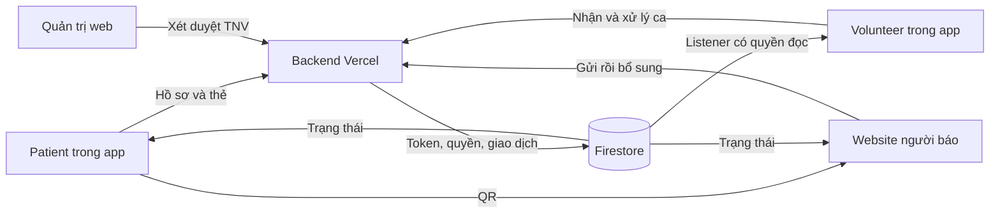

# EHIS Next — thẻ sức khỏe và hỗ trợ cộng đồng

Dự án Capstone viết mới cho nhóm 4 người. Repository chứa **toàn bộ hệ thống**: một app Patient/Volunteer, website người báo/quản trị và backend dùng Firebase làm nơi lưu dữ liệu tập trung.

> [!IMPORTANT]
> **Mới vào nhóm?** Đọc [bản đồ mã nguồn](docs/REPO_MAP.md) → [chạy local](docs/LOCAL_DEVELOPMENT.md) → [phân công](docs/TEAM.md).
>
> **Hiểu hệ thống và xử lý lỗi:** [Vai trò Expo / GitHub / Vercel / Firebase](docs/PLATFORM_ROLES.md) · [Quy trình sửa lỗi và ghi lab note](docs/BUG_FIX_WORKFLOW.md). Mọi phiên có thay đổi đều phải ghi [LAB_NOTES.md](docs/LAB_NOTES.md), kể cả kết quả chưa đạt.
>
> **Về nhánh Git:** `main` là nhánh tích hợp. Bản triển khai v0.4 đang được review ở [PR #1](https://github.com/Hoangcamng03/EHIS-Next/pull/1), nhánh `feat/bystander-two-step-report`. Nhánh đó có toàn bộ phần phát triển mới; tên xuất phát từ công việc đầu tiên. Các thư mục mới là cách chia code theo chức năng. Merge sau khi thành viên khác review và CI đạt.

## 1. Sản phẩm và các giao diện

| Sản phẩm | Người dùng | Code | Kết quả build / nơi chạy |
|---|---|---|---|
| App EHIS | Patient và Volunteer, ghi nhớ đối tượng khi đăng ký và tự mở sau đăng nhập | [mobile/](mobile/README.md) | Ưu tiên nghiệm thu web 0.4.3; APK 0.4.1 cũ; iOS chưa phát hành |
| Website EHIS | Người qua đường mở QR; quản trị vào `/admin` | [web/](web/README.md) | Website tĩnh HTTPS trên Firebase Hosting |
| Backend EHIS | App và website gọi API | [functions/](functions/README.md) | Node/Express trên Vercel Hobby |
| Dữ liệu / xác thực | Tài khoản, hồ sơ, thẻ, ca và quyền đọc | [Firebase config](docs/REPO_MAP.md#4-cấu-hình-và-dữ-liệu) | Firebase Auth + Firestore Standard Singapore |

Patient và Volunteer là hai khu vực của **cùng một app**. Trang quản trị thuộc website. App xuất ra web dùng cùng code React Native; đó là giao diện khác website người qua đường.

Theo quyết định mới: [hoàn thiện và duyệt web trước](docs/WEB_TRIAL.md), rồi mới phát hành Android/iOS mới. Không phát OTA/APK trong giai đoạn chờ duyệt web. Lựa chọn đối tượng được lưu qua backend và chỉ quyết định giao diện; quyền TNV vẫn cần quản trị xét duyệt.

Web 0.4.3 có [công tắc sẵn sàng, cảnh báo chuông/rung và bản đồ sau nhận ca](docs/VOLUNTEER_ALERTS.md). Chuông nghiệm thu khi trang mở phía trước; chưa phải thông báo nền của điện thoại.

## 2. Cấu trúc repository

```text
EHIS-Next/
├── mobile/                 App React Native / Expo: Patient + Volunteer
│   ├── src/app/            Màn hình và điều hướng
│   ├── src/components/     Form, nút, bản đồ và trạng thái
│   └── src/lib/            Firebase client, gọi API, tuyến đường
├── web/                    Next.js: người báo + quản trị
│   ├── src/app/            /card, /report, /admin, /privacy
│   ├── src/components/     Gửi yêu cầu, bảng hỏi, duyệt TNV
│   └── src/lib/            Firebase client và phiên web
├── functions/              Backend nghiệp vụ và phân quyền
│   ├── src/                API TypeScript, validation, bảo trì
│   ├── api/                Điểm vào Vercel
│   └── test/               Unit tests backend
├── scripts/                Công cụ local, kiểm tra và triển khai
├── docs/                   Hướng dẫn, kiến trúc, API và lab note
├── .github/                CI và mẫu PR
├── firebase.json           Hosting, Auth, Emulator và đường dẫn backend
├── firestore.rules         Quyền đọc/ghi trực tiếp của client
├── firestore.indexes.json  Index truy vấn
└── package.json            Các lệnh điều phối từ thư mục gốc
```

Mỗi module có README riêng. [REPO_MAP.md](docs/REPO_MAP.md) chỉ rõ từng file và luồng phối hợp; [scripts/README.md](scripts/README.md) phân loại công cụ.

## 3. Dòng hoạt động



Backend xác nhận đã nhận yêu cầu thì web mới chuyển bảng hỏi; phone người báo không bắt buộc. TNV được duyệt và nhận đúng ca mới xem thông tin riêng phù hợp consent. Client write trực tiếp vào Firestore bị chặn; thay đổi nghiệp vụ đi qua API. Xem [kiến trúc](docs/ARCHITECTURE.md) và [API contract](docs/API_CONTRACT.md).

## 4. Bản chạy thử cloud

| Mục | Đường dẫn |
|---|---|
| App Patient / Volunteer trên web | https://ehis-next-20261021-hc03-app.web.app |
| Website người báo | https://ehis-next-20261021-hc03.web.app |
| Quản trị | https://ehis-next-20261021-hc03.web.app/admin |
| APK Android | [Cài và thử Android](docs/ANDROID_TRIAL.md) |
| Cập nhật web + điện thoại | [Bản phát hành và quy trình đồng bộ](docs/MOBILE_RELEASES.md) |
| Tài khoản thử | [Mục nổi bật trong lab note](docs/LAB_NOTES.md#tài-khoản-chạy-thử--mục-bàn-giao) |
| Email + mật khẩu thử (riêng tư) | [EHIS-Next-Team-Access](https://github.com/Hoangcamng03/EHIS-Next-Team-Access) — hiện chỉ chủ dự án có quyền |
| Kết quả / giới hạn | [STATUS.md](docs/STATUS.md), [kiểm chứng v0.4](docs/VERIFICATION_V0_4.md) |

Cloud dùng Firebase **Spark** (Auth/Firestore/Hosting) + **Vercel Hobby** (backend), project riêng `ehis-next-20261021-hc03`. `functions/` giữ tên lúc khởi tạo Firebase; backend hiện không deploy Firebase Functions. App độc lập không cần laptop; thao tác dữ liệu cần Internet.

Chỉ dùng dữ liệu giả. Chưa nghiệm thu Android thật; đã có báo cáo Play Protect chặn cài đang cần xử lý. Chưa có push/GPS nền, dẫn đường liên tục, NFC hoặc iOS signing. Không tắt bảo vệ thiết bị để nghiệm thu. [Trạng thái chi tiết](docs/STATUS.md).

## 5. Bắt đầu làm việc

1. Chọn nhánh theo [quy trình đóng góp](CONTRIBUTING.md).
2. Cài và chạy theo [LOCAL_DEVELOPMENT.md](docs/LOCAL_DEVELOPMENT.md).
3. Đọc README của module mình phụ trách và [TEAM.md](docs/TEAM.md).
4. Thống nhất [API](docs/API_CONTRACT.md) trước khi sửa phần kết nối giữa các module.
5. Kiểm tra, mở PR và nhờ thành viên khác review.

```powershell
npm run check
npm --prefix web run build
npm run test:integration
```

Build APK và triển khai cloud là bước riêng: [CLOUD_TRIAL.md](docs/CLOUD_TRIAL.md), [ANDROID_TRIAL.md](docs/ANDROID_TRIAL.md). [Danh mục tài liệu](docs/README.md) phân biệt hướng dẫn hiện tại với kết quả lịch sử.

Mật khẩu, token, service account, keystore, file môi trường và hồ sơ thật không được đưa vào Git. `.local/`, build output và `node_modules/` là dữ liệu riêng/tự sinh. Xem [lab note](docs/LAB_NOTES.md) để biết thay đổi đã thực hiện.
