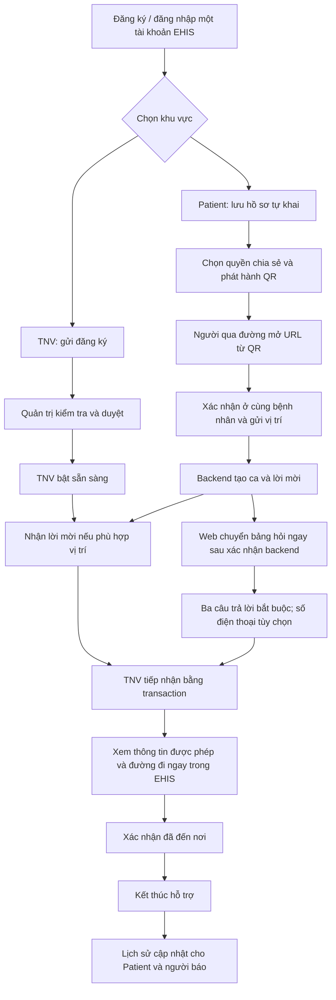

> Hướng dẫn PC local v0.3 được giữ để tham khảo. Bản cloud v0.4 mới nhất: [CLOUD_TRIAL.md](CLOUD_TRIAL.md), [STATUS.md](STATUS.md).

# EHIS · Bản thử v0.3 và luồng hoàn chỉnh

Bản này hoàn thành một **MVP chạy thử có kiểm soát trên PC**: một app React Native chung Patient/TNV, website người báo và trang quản trị. Đây chưa phải ứng dụng đã phát hành hoặc hệ thống cấp cứu ngoài thực địa.

## Luồng từ đầu đến cuối



Chỉ chọn khu vực không cấp quyền. Một tài khoản có thể dùng cả hai; TNV không được mời hỗ trợ ca của chính hồ sơ tài khoản đó. Quản trị nằm trên web, không phải vai trò người dùng tự chọn trong app.

## Mỗi bên thao tác thế nào?

| Bên | Thao tác | Điều kiện thành công |
|---|---|---|
| Patient | Đăng ký → chọn Bệnh nhân → nhập tên, dị ứng đã biết, liên hệ khẩn cấp → lưu | Backend lưu theo UID; mở lại khôi phục đúng hồ sơ |
| Patient | Chọn chia sẻ hoặc không → phát hành QR | Một thẻ active/Patient; retry không tạo nhiều thẻ |
| TNV | Đăng ký bằng tài khoản riêng → chọn TNV → gửi tên, số liên hệ, kinh nghiệm tự khai | Trước duyệt chỉ thấy trạng thái chờ, không bật sẵn sàng |
| Quản trị | Đăng nhập web bằng tài khoản có claim admin → tải đơn → duyệt/từ chối | Mỗi API tự kiểm tra claim, không tin nút UI |
| TNV | Bật sẵn sàng bằng GPS; chỉ local mới có vị trí giả | Server xác nhận và cập nhật lastSeen |
| Người báo | Mở URL QR → xác nhận ở cạnh bệnh nhân → gửi vị trí | Chỉ chuyển bước khi backend ack; không chờ TNV nhận |
| Người báo | Chọn đủ ba đáp án, có thể không nhập phone → gửi | Cùng ca nhận bản bổ sung, không tạo ca thứ hai |
| TNV | Nhận ca → xem báo cáo và hồ sơ nếu Patient cho phép | Chỉ một người nhận; trước nhận không có danh tính/vị trí chính xác |
| TNV | Bấm xem đường trong EHIS → xác nhận đã đến → kết thúc | Hai điểm A–B, tuyến và ước tính; ca đóng thu hồi API riêng tư |
| Patient | Theo dõi lịch sử; hủy yêu cầu nhầm trước khi được nhận | Không hủy ca đã có TNV; số liên hệ người báo không public |
| Patient | Xác nhận thu hồi QR khi không có ca active → cấp lại | QR cũ bị từ chối; QR mới có mã khác |

Số liên hệ khẩn cấp của Patient cũng có thể để trống; không bắt buộc phải có người liên hệ để dùng thẻ. Hồ sơ hiện là schema tối thiểu ba trường, chưa phải bệnh án đầy đủ. Không suy ra chẩn đoán từ đáp án. Việc duyệt TNV trong phần mềm không chứng nhận năng lực y tế; quy trình kiểm tra người thật thuộc nhóm vận hành.

## Những điểm thiết kế đã chỉnh

- Expo Go chỉ là cách xem lúc phát triển. Không coi mã QR mở Expo Go là thẻ bệnh nhân.
- QR bệnh nhân chỉ chứa URL có mã ngẫu nhiên mạnh; không nhúng tên, phone hay dị ứng.
- Tách quyền Patient/TNV/Quản trị; có quy trình duyệt thật, không tự ghi approved.
- Không gửi bệnh nhân đến chính họ khi tài khoản có cả hai vai trò.
- Backend ack khác TNV nhận ca: web mở bảng hỏi ngay sau ack.
- Không hứa có người nhận khi không có TNV phù hợp; gửi thành công chỉ là máy chủ đã nhận.
- Vị trí người báo chỉ dùng sau khi xác nhận cùng chỗ bệnh nhân; không lấy vị trí nhà từ hồ sơ.
- Đường thẳng lúc dispatch khác quãng đường ô tô. Xem đường trong EHIS không bắt buộc chuyển Google Maps; chưa có dẫn giọng nói hoặc tự reroute.
- Bổ sung không làm mất tuyến đang xem; kết thúc ca gỡ thông tin riêng và giải phóng thẻ/TNV.
- Patient có quyền hủy yêu cầu nhầm trước accept; QR bị mất có thể thu hồi sau khi ca đã đóng.
- Trên PC local, Firebase Auth tách theo tab để Patient/TNV demo đồng thời; phiên quản trị còn tách khỏi người báo. Mobile giữ phiên qua AsyncStorage.
- Rời khu vực TNV tắt sẵn sàng; không âm thầm giữ online khi chuyển qua Patient.
- Emulator lưu snapshot khi dừng đúng cách và khôi phục lần chạy tiếp; vẫn nên snapshot trước khi đóng cưỡng bức bằng `npm run trial:snapshot`.

## Chạy bản thử trên máy tính

Mở thư mục repo. Cần Node tương thích lockfile và Java 21. Chỉ cài lần đầu:

```powershell
npm --prefix mobile ci
npm --prefix web ci
npm --prefix functions ci
npm run setup:local
npm run doctor:local
```

Giữ ba terminal:

```powershell
# Terminal A: Auth / Firestore / Functions
npm run emulators
```

```powershell
# Terminal B: website + quản trị
npm run web
```

```powershell
# Terminal C: cùng app React Native, xem trên PC
npm run mobile:web
```

Mở app `http://localhost:8082`. Tạo Patient bằng giao diện đăng ký; một tab khác đăng nhập TNV. Để tạo bộ tài khoản giả gồm quản trị trong Emulator, dùng `npm run trial:prepare`. Thông tin nằm trong `.local/complete-demo.json`, không commit hoặc dùng cho cloud.

Sau buổi thử, chạy `npm run trial:snapshot` khi Emulator còn hoạt động để lưu dữ liệu giả. Lần `npm run emulators` tiếp theo tự nhập snapshot nếu có; các thay đổi sau snapshot cuối có thể mất khi tiến trình bị tắt cưỡng bức. Khi khởi động lại Auth Emulator, phiên cũ có thể không còn hợp lệ: đăng nhập lại để thấy hồ sơ, thẻ và lịch sử đã nhập.

Quản trị local: `http://localhost:3100/admin`. Tài khoản quản trị giả được script đặt claim bằng Admin SDK trong **demo-ehis-next**, không có API tự cấp quyền trên app. Không dùng tài khoản cá nhân/khách hàng để chạy thử.

TNV giả ở `10.7769,106.7009`; bệnh nhân giả ở `10.779,106.699`. Bật sẵn sàng trước khi gửi. Mở URL hiện dưới QR bằng trình duyệt mô phỏng người quét; QR localhost không mở được backend này trên điện thoại. Để QR quét được từ điện thoại cần HTTPS và cấu hình `EXPO_PUBLIC_BYSTANDER_URL` đúng môi trường.

Chỉ nhập hồ sơ giả. Bản đồ cần Internet, dù Auth/DB/Functions chạy local. Chưa có hàng đợi cấp cứu offline.

## Kiểm thử và nguồn mã

`npm run check`: typecheck/lint ba module, validation và navigation tests. `npm run test:integration`: Emulator mới trên các port đã cấu hình; tắt Emulator đang dùng trước khi chạy để tránh xung đột. Nếu muốn giữ dữ liệu demo, snapshot trước. `node scripts/run-integration.cjs` dùng Emulator đang sẵn sàng nhưng chỉ chạy với các tài khoản/tài liệu giả riêng.

Bộ mới `smoke-lifecycle.cjs` kiểm tra không có hồ sơ thì không cấp thẻ; cấp thẻ đồng thời; cross-user/anonymous/role injection; admin duyệt; không self-dispatch; trạng thái arrived; kết thúc; chia sẻ true/false; thu hồi và cấp lại; Patient hủy ca.

## Từ bản PC đến APK thật

Chưa có APK/IPA, tài khoản EAS liên kết, signing hay cloud backend được deploy. Cài Expo Go/quét QR trước đây không xác nhận đã có tài khoản build.

1. Người giữ tài khoản Expo chạy `npx eas-cli@latest login` trong `mobile/`, không gửi mật khẩu vào chat.
2. Tạo/liên kết EAS project mới của nhóm: `npx eas-cli@latest init`.
3. Chọn môi trường: development build kết nối Emulator qua USB/LAN cần laptop; hoặc standalone preview kết nối cloud HTTPS cần provision Auth/Firestore/Functions/web và quyết định chi phí riêng. Chưa tự bật billing.
4. Với môi trường preview đã sẵn sàng: `npx eas-cli@latest build --platform android --profile preview` xuất APK. `production` dùng AAB. Không build demo-key/localhost rồi coi đó là bản độc lập hoạt động khi laptop tắt.
5. Thử lại toàn bảng trên Android thật: quyền GPS, mở/đóng giữ phiên, QR từ điện thoại, hai tài khoản, map WebView, mất mạng, đi thực tế. Xuất mã Android/đạt kiểm tra PC chưa thay thế bước này.

## Cổng trước thử nghiệm người thật

Chưa có thông báo đẩy/GPS nền, Navigation SDK theo dõi khi di chuyển, NFC trên máy thật, scheduler hết hạn/mời lại theo đợt, App Check/throttle, retention/xóa dữ liệu và quy trình xác minh TNV thực. Các advisory upstream chưa được coi là sạch. Đây là các mục cản phát hành thực địa, không được giấu dưới nhãn “app hoàn chỉnh”. Xem SECURITY_REVIEW.json và NAVIGATION.md.
