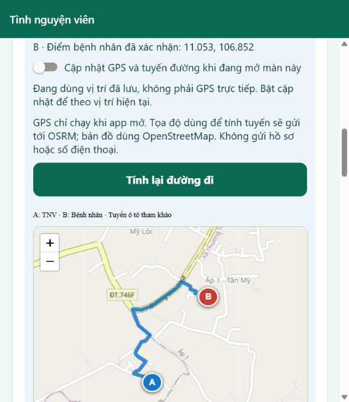

# 0.4.6 — GPS trước màn hình và điểm bệnh nhân được xác nhận

## Thay đổi đã chốt với chủ dự án

- EHIS gửi yêu cầu tới TNV; bỏ nút gọi 115 khỏi web. Không tích hợp tổng đài. Chỉ diễn tập có kiểm soát, chưa nhận ca thật.
- TNV chỉ theo dõi GPS khi đang mở màn chỉ đường và đã bật công tắc. Chuyển nền dừng theo dõi; không yêu cầu quyền vị trí nền.
- Điểm B giữ nguyên khi người báo đi nơi khác. Sau khi TNV nhận ca, người báo có thể lấy GPS mới → xác nhận đang cạnh bệnh nhân → xác nhận đổi điểm → chờ máy chủ phản hồi.
- Trước khi ca được nhận, nếu sai điểm thì hủy và gửi lại để chọn TNV theo điểm đúng. Không âm thầm đổi vị trí của một lời mời đang gửi cho nhiều người.

## Nhóm cần hiểu cách vận hành

1. `use-live-location.ts` xin quyền foreground, đăng ký theo dõi và hủy khi tắt/nền/unmount. Đề nghị High accuracy, khoảng cách 3m; chu kỳ 3 giây chỉ là yêu cầu trên Android, không phải cam kết trên mọi máy.
2. `live-location.ts` chặn điểm không hợp lệ, sai số trên 100m, cũ hơn 15 giây hoặc thời gian tương lai bất thường. Màn hình hiện sai số ước tính và tuổi điểm; GPS thiết bị không bảo đảm tọa độ tuyệt đối chính xác.
3. `LiveIncidentNavigation.tsx` cập nhật marker A và tính lại tuyến khi di chuyển ít nhất 20m, cách lần trước tối thiểu 15 giây. Đứng yên làm mới tối đa mỗi 60 giây. Điểm B mới được tính lại ngay. Timeout 15 giây; mất mạng/đổi điểm/nền thì hủy kết quả cũ, không tạo tuyến giả.
4. `PersistentRouteMap.web.tsx` và `RouteMap.tsx` giữ bản đồ, di chuyển marker/polyline thay vì tạo lại toàn bộ mỗi lần GPS đổi. Giữ pan/zoom khi cập nhật A.
5. `UpdatePatientLocation.tsx` chỉ gửi sau hai thao tác lấy và xác nhận điểm. `updateIncidentLocation` kiểm tra đúng phiên người báo, ca accepted/arrived, chống gửi lặp; đổi private/location và báo revision mới cho đúng TNV phụ trách. Điểm cũ ẩn trong lúc chưa tải được revision mới.
6. API bản đồ OSRM và tiles OSM vẫn là dịch vụ public cho diễn tập, không có traffic trực tiếp, giọng nói hay cam kết thời gian đến. Tọa độ gửi tới nhà cung cấp; không kèm UID, phone, hồ sơ, mã QR. Không ghi lịch sử GPS liên tục lên Firestore.

## Nghiệm thu theo thứ tự

1. Chạy `npm run check` rồi `npm run test:integration`; chỉ dùng Emulator và dữ liệu giả.
2. Cloud: chuẩn bị ca giả → gửi → nhận → đổi điểm đã xác nhận → TNV thấy điểm mới/tuyến mới → bổ sung quan sát không phone → đến nơi/kết thúc → API private và đổi điểm mới đều bị chặn.
3. Browser: xem cảnh báo màu đỏ, đúng giao diện đối tượng, không còn nút 115; GPS tắt ban đầu, rõ thông báo vị trí cũ. Không coi điểm giả là kiểm thử GPS thật.
4. Điện thoại, ngoài trời và đi bộ an toàn: bật vị trí chính xác; A di chuyển; thấy sai số/tuổi điểm; từ chối quyền, mất mạng, khóa máy/quay lại, tắt công tắc. B không tự di chuyển. Người báo xác nhận đổi B, TNV thấy thông tin mới. Không thao tác máy khi đang lái xe.
5. Android cần cài APK 0.4.6 mới; APK 0.4.5 không tự có GPS mới. iOS web thử được trước; iOS native cần TestFlight/cấu hình ký và nghiệm thu riêng.

## iPhone — lựa chọn phù hợp

| Cách | Cần trả phí Apple? | Phù hợp |
| --- | --- | --- |
| Safari → Thêm vào màn hình chính | Không | Thử flow web ngay, vẫn cần Internet |
| Mac + Xcode Personal Team | Không | Thử cá nhân; provisioning hết hạn 7 ngày, cần build/cài lại; không phải link tải chung |
| Apple Developer Program + TestFlight | Có, niêm yết 99 USD/năm, giá địa phương theo Apple | Đề xuất cho nhóm thử native bằng link mời sau khi hoàn tất demo |

Chủ tài khoản tự đăng ký, xác minh và trả phí; không gửi mật khẩu/mã xác thực vào chat. Không cần mua chỉ để thử bản web. TestFlight không đồng nghĩa đã phát App Store hoặc đã đủ điều kiện tiếp nhận ca thật.

Nguồn chính thức kiểm tra ngày 2026-10-23: [Apple account/Xcode](https://developer.apple.com/help/account/basics/about-your-developer-account), [Apple Program](https://developer.apple.com/programs/enroll/), [Safari](https://support.apple.com/guide/iphone/bookmark-a-website-iph42ab2f3a7/ios), [Expo Location 58](https://docs.expo.dev/versions/v58.0.0/sdk/location/), [WebView](https://github.com/react-native-webview/react-native-webview/blob/master/docs/Reference.md).

Kết quả code, deploy, artifact và thiết bị được ghi riêng trong [lab note](LAB_NOTES.md); chưa coi các bước checklist là đã đạt.

## Kết quả đã xác nhận

- Source runtime `5bfd4af02a19aa935a0b5aa8bf24412af81f9850`; [CI 39992904086](https://github.com/Hoangcamng03/EHIS-Next/actions/runs/39992904086) SUCCESS.
- 31 unit/logic, sáu bộ integration Emulator PASS. Android/iOS JS export PASS, không phải IPA hoặc nghiệm thu hardware.
- Backend Vercel READY/health 0.4.6 đúng project; cả hai Hosting deploy và 32 đối chiếu byte HTML/JS/CSS PASS.
- Browser/cloud ca giả: nhận ca → tuyến 0,44km → đổi B từ 11.052/106.851 sang 11.053/106.852 → tuyến 0,72km và nhãn đổi điểm. Bổ sung không phone revision 2; gửi lại vẫn revision 2 và giữ điểm. Đến nơi/kết thúc trên UI; API private và đổi điểm mới bị chặn; fixture TNV không sẵn sàng khi bàn giao.
- Chưa bấm công tắc lấy GPS thật, chưa kiểm thử di chuyển ngoài trời, iPhone Safari/loa/rung/khóa màn hình hoặc native WebView. Không suy từ tọa độ giả ra độ chính xác thiết bị.

Trang tải: [EHIS trên điện thoại](https://ehis-next-20261021-hc03.web.app/install). [Ảnh kiểm tra link Android 0.4.6](assets/trial-046/install.jpg). APK mới đang build, chưa coi đã cài hoặc đã nghiệm thu thiết bị.
