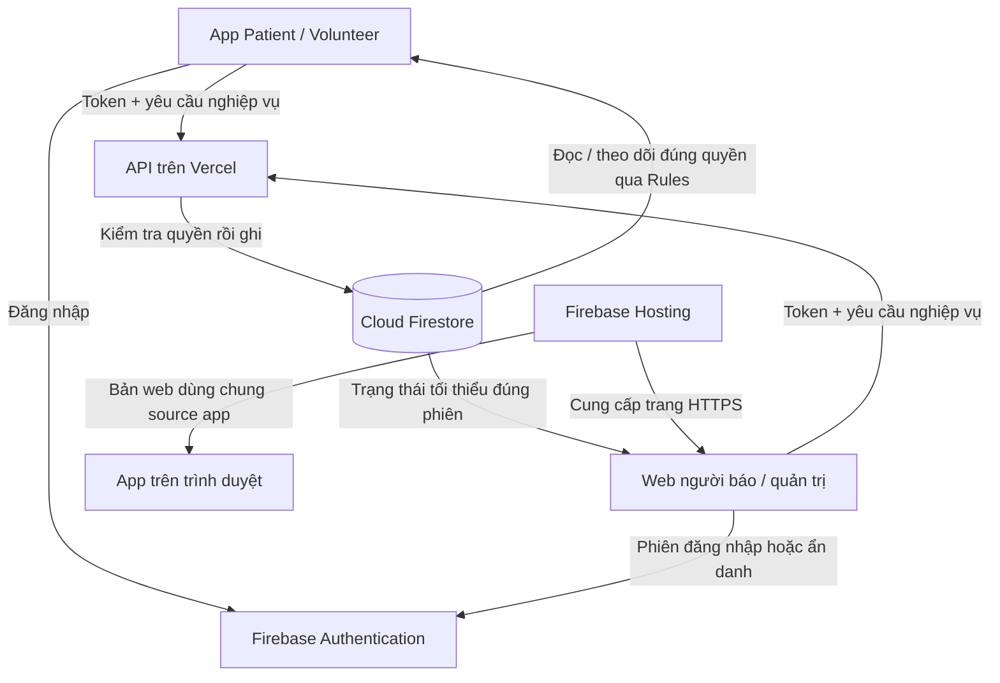
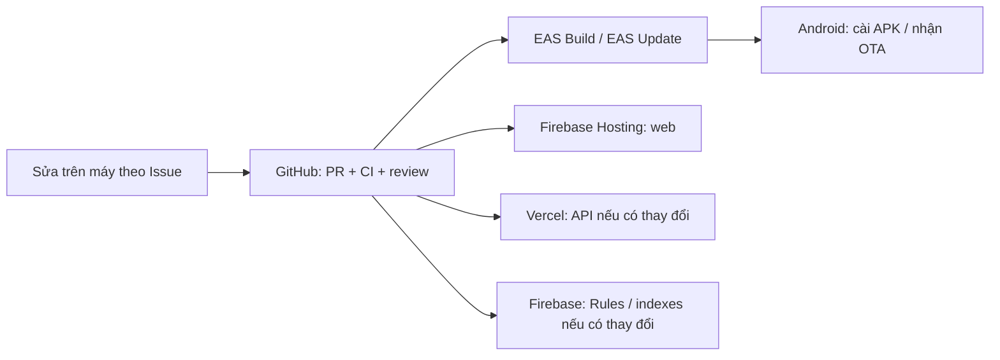

# Expo, GitHub, Vercel và Firebase trong EHIS

Tài liệu theo cấu hình source hiện tại ngày 2026-10-22. Bốn nền tảng phối hợp để tạo, phát hành và vận hành hệ thống; mỗi nền tảng có trách nhiệm riêng.

## 1. Bảng vai trò

| Nền tảng | Cách hiểu | EHIS dùng để làm gì? | Nơi cần tìm |
|---|---|---|---|
| Expo / EAS | Bộ công cụ làm và phát hành app | Expo hỗ trợ React Native; EAS Build tạo APK có mã chạy nhúng; EAS Update gửi thay đổi JavaScript/tài nguyên tương thích | `mobile/`, `mobile/app.json`, `mobile/eas.json`, [bản phát hành](MOBILE_RELEASES.md) |
| GitHub | Kho mã nguồn và nơi phối hợp nhóm | Lưu toàn hệ thống, lịch sử thay đổi, Issue, PR, tài liệu, CI kiểm tra tự động | README gốc, `.github/`, [quy trình nhóm](../CONTRIBUTING.md) |
| Vercel | Nơi chạy backend trên Internet | Chạy API Node/Express: xác minh token/quyền, kiểm tra dữ liệu, tạo/nhận/kết thúc ca và ghi Firestore | `functions/src/`, `functions/api/`, [cloud trial](CLOUD_TRIAL.md) |
| Firebase | Xác thực, cơ sở dữ liệu và nơi đặt web | Authentication quản lý đăng nhập; Firestore lưu dữ liệu; Rules hạn chế client; Hosting phục vụ hai bản web qua HTTPS | `firestore.rules`, `firestore.indexes.json`, `firebase.json`, [kiến trúc](ARCHITECTURE.md) |

Tên thư mục `functions/` có từ lúc khởi tạo. Backend cloud hiện chạy trên **Vercel**, chưa deploy Firebase Cloud Functions. Hosting website hiện nằm ở **Firebase**, không ở Vercel. GitHub đang chạy CI kiểm tra; push code không tự chứng minh đã triển khai cloud hay cập nhật điện thoại.

## 2. Khi người dùng thao tác

Ví dụ: Patient lưu hồ sơ → app gửi token và dữ liệu tới API Vercel → API kiểm tra người sở hữu → ghi Firestore. Người qua đường quét QR → Firebase Hosting mở web → web gửi yêu cầu qua API → sau xác nhận mới sang bảng hỏi → Firestore lưu ca và cập nhật thông tin cho đúng Volunteer có quyền. Chọn Volunteer trên UI không tự cấp quyền nhận ca.

Firestore lưu hồ sơ/tài khoản nghiệp vụ/thẻ/ca; Authentication giữ thông tin xác thực đăng nhập. Mật khẩu không được lưu trong document hồ sơ. Khóa quản trị backend không được đưa vào app, website hoặc GitHub public.

## 3. Khi nhóm phát triển và phát hành

Các mũi tên phát hành là quy trình do người phụ trách chạy, chưa phải pipeline tự deploy mọi thứ. Với thay đổi app, phát hành web và Android theo [MOBILE_RELEASES.md](MOBILE_RELEASES.md). Backend/Rules chỉ triển khai khi bị ảnh hưởng và đã kiểm tra tương thích với app cũ.

Expo Go dùng để xem app lúc phát triển; APK độc lập không cần Expo Go hoặc laptop bật. Bản APK 0.4.1 mới có cơ chế OTA đã cấu hình. Thay đổi native cần APK mới; OTA tải khi có Internet và áp dụng khi mở lại phù hợp. App vẫn cần Internet để gửi yêu cầu, lấy dữ liệu mới và tải bản đồ. Khả năng mở app không có mạng không đồng nghĩa gọi hỗ trợ thành công.

## 4. Khi gặp lỗi, tìm nơi nào trước?

| Biểu hiện | Bắt đầu kiểm tra |
|---|---|
| Build APK thất bại / phiên bản không cập nhật | EAS build/update, fingerprint, channel và [Android trial](ANDROID_TRIAL.md) |
| Đăng nhập thất bại | Auth, kết nối mạng và cấu hình đúng môi trường; không chia sẻ mật khẩu/token |
| Lưu hồ sơ / gửi ca lỗi | Network/API rồi log Vercel đã loại thông tin riêng; kiểm tra UID/quyền và validation |
| Dữ liệu không hiện hoặc quyền đọc bị từ chối | API/projection, Firestore Rules/index và tài khoản đang dùng |
| QR mở sai trang | URL trong QR, Firebase Hosting và phiên bản app cấp thẻ |
| Bản đồ không lên | Quyền vị trí, mạng, Leaflet/WebView/OSRM; xem [NAVIGATION.md](NAVIGATION.md) |
| Không rõ source mới ở đâu | Nhánh/commit/PR trên GitHub, [STATUS.md](STATUS.md) và lab note |

## 5. Tài liệu chính thức

- [Expo Application Services](https://docs.expo.dev/eas/).
- [GitHub và quy trình phát triển](https://docs.github.com/en/get-started/start-your-journey/what-is-github).
- [Vercel Functions](https://vercel.com/docs/functions).
- [Cloud Firestore](https://firebase.google.com/docs/firestore), [Firebase Authentication](https://firebase.google.com/docs/auth), [Firebase Hosting](https://firebase.google.com/docs/hosting).

Các link trên giải thích nền tảng. Trạng thái EHIS đã triển khai/đã thử phải tra bằng chứng trong tài liệu dự án.
