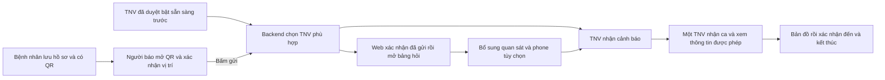

# EHIS — thành viên mới bắt đầu từ đây

Cập nhật 25/10/2026. Dành cho cả thành viên chưa rành lập trình. [Danh mục đầy đủ theo tám nhóm](README.md) · [Tra phiên bản](STATUS.md).

**Thứ tự đọc trang này:** [1. Mục tiêu](#muc-tieu) → [2. Hiểu hệ thống](#he-thong) → [3. Chuẩn bị](#chuan-bi) → [4. Chạy demo](#chay-demo) → [5. Kiểm tra](#kiem-tra) → [6. Làm tiếp](#lam-tiep).

## 1. Mục tiêu và phiên bản

Trang này giúp bạn biết hệ thống gồm gì, lấy đúng tài khoản, chuẩn bị thiết bị và phối hợp demo. Đây là diễn tập phần mềm với dữ liệu giả để trình thầy/lớp; chưa tiếp nhận cấp cứu thật.

Tra [STATUS](STATUS.md) trước khi bắt đầu: mốc bàn giao 25/10 là frontend/web/APK 0.4.7; bản sửa 0.4.8 còn local/chưa phát hành. Có tài liệu hoặc ảnh 0.4.8 không có nghĩa app đang cài đã có các nút mới.

## 2. Hiểu hệ thống trước khi bấm

### 2.1. Các phần và nơi mở

| Phần | Ai dùng | Mở ở đâu |
| --- | --- | --- |
| Một app, hai khu vực | Bệnh nhân và TNV | [App web](https://ehis-next-20261021-hc03-app.web.app) hoặc [trang cài APK Android](https://ehis-next-20261021-hc03.web.app/install) |
| Web báo hỗ trợ | Người qua đường | Quét QR của Patient hoặc mở link QR trong bảng riêng tư; không đăng nhập |
| Web quản trị | Người phụ trách duyệt TNV | [Trang quản trị](https://ehis-next-20261021-hc03.web.app/admin) |
| Bảng đăng nhập | Chủ dự án và người được cấp quyền | [Repo riêng tư](https://github.com/Hoangcamng03/EHIS-Next-Team-Access), mục đầu ngày 25/10/2026 |

### 2.2. Luồng hoạt động

- **Đã gửi** nghĩa là máy chủ đã nhận, chưa có nghĩa TNV đã nhận hoặc đã đến.
- QR không chứa bệnh án hay vị trí trực tiếp. Điểm hỗ trợ lấy từ thiết bị người báo khi họ xác nhận đang cạnh bệnh nhân.
- Người báo không xem hồ sơ y tế; chỉ TNV đúng ca, sau khi nhận và theo lựa chọn chia sẻ của Patient, mới được xem thông tin riêng.
- Hai TNV tranh một ca: chỉ một người được nhận. Không dùng chung một tài khoản cho hai người để thử tranh ca.

### 2.3. Nền tảng dùng để làm gì?

| Tên | Ý nghĩa trong dự án |
| --- | --- |
| GitHub | Lưu source, hướng dẫn, Issue và lab note; không phải nơi app lưu bệnh án |
| Expo/EAS | Công cụ phát triển/đóng gói APK; người chạy APK độc lập không cần Expo Go |
| Vercel | Chạy backend xử lý yêu cầu và kiểm tra quyền |
| Firebase | Xác thực đăng nhập, Firestore lưu dữ liệu và Hosting phục vụ web |

Người demo chỉ cần app/web và tài khoản được cấp, không cần quyền Vercel/Firebase/Expo.

## 3. Chuẩn bị tài khoản và thiết bị

### 3.1. Lấy đúng tài khoản

| Mã | Vai trò | Chuẩn bị sẵn để làm gì |
| --- | --- | --- |
| P1 | Patient 01 | QR có chia sẻ hồ sơ giả |
| P2 | Patient 02 | QR không chia sẻ hồ sơ; thử quyền riêng tư |
| V1, V2 | Hai TNV | Đã duyệt cho diễn tập, tắt sẵn sàng khi bàn giao |
| V3 | TNV chờ duyệt | Thử ứng tuyển và quản trị |
| A1 | Quản trị | Duyệt V3 ở web /admin; không dùng A1 trong app Patient/TNV |

Trạng thái trong bảng là khi cấp tài khoản; kiểm tra lại trong app nếu nhóm đã dùng thử trước đó. Email/mật khẩu và hai link QR nằm trong repo riêng tư; không có ở trang public này. Tài khoản GitHub để đọc tài liệu khác tài khoản EHIS để đăng nhập app.

**Nếu thành viên gặp 404 ở repo mật khẩu:** hiện repo chỉ chủ dự án có quyền. Chủ dự án có thể trực tiếp phân/điền tài khoản trong buổi thử; nếu muốn thành viên tự xem, chủ repo tự mời đúng GitHub username qua Settings → Collaborators → Add people, rồi thành viên chấp nhận lời mời. Repo cá nhân cấp quyền collaborator có cả quyền sửa nội dung; chủ dự án cần chọn người phù hợp. Không bật public hoặc dùng chung tài khoản GitHub của chủ repo. Đây là hướng dẫn, chưa tự mời ai. [Nguồn GitHub về lời mời](https://docs.github.com/en/repositories/managing-your-repositorys-settings-and-features/repository-access-and-collaboration/inviting-collaborators-to-a-personal-repository), [phạm vi quyền collaborator](https://docs.github.com/en/repositories/managing-your-repositorys-settings-and-features/repository-access-and-collaboration/permission-levels-for-a-personal-account-repository).

Email `.test` là giả, không nhận thư Quên mật khẩu/xác minh. Tài khoản local/Emulator không dùng được trên cloud/APK. [Chi tiết bộ tài khoản](demo/MANUAL_DEMO_ACCOUNTS.md).

### 3.2. Kiểm tra thiết bị trước buổi thử

- Internet, một laptop và từ hai Android. Dùng bản HTTPS cloud; không nhập localhost trên điện thoại, không cần chạy PowerShell/Expo Go hoặc cài Firebase để tham gia demo.
- Nếu cài APK: tải ở trang cài trên, kiểm tra số phiên bản trong app. Nếu bị chặn, ghi cảnh báo và dùng web để thử giao diện; phần APK vẫn chưa được nghiệm thu. Không tắt Play Protect để bỏ qua cảnh báo.
- Bật dịch vụ vị trí và cho phép vị trí cho app/trình duyệt khi được hỏi. TNV thử chuông trước; giữ màn TNV mở phía trước. Chưa bảo đảm nhận khi khóa máy/đưa nền.
- Các bên đứng gần nhau trong khu thử, ngồi đủ xa để nghe thiết bị nào reo. Người báo phải đứng cạnh bệnh nhân giả; không lái xe khi thao tác.
- Chỉ dữ liệu giả, không đưa mật khẩu, số liên lạc thật hay vị trí chính xác vào ảnh/slide public. Một người quan sát và ghi kết quả, không phải cả bốn người cùng bấm.

**Checkpoint:** mọi người mở đúng địa chỉ, được phân đúng tài khoản, biết ai ra hiệu gửi/nhận/kết thúc và mở được [runbook](demo/DEMO_RUNBOOK.md).

## 4. Phân vai và chạy một vòng hoàn chỉnh

1. Mở [DEMO_RUNBOOK](demo/DEMO_RUNBOOK.md), phân rõ người đóng Patient, người báo, TNV và người quan sát. Nếu chỉ hai Android, dùng cách bố trí laptop đã ghi trong runbook.
2. Kiểm tra Patient có QR; TNV đúng tài khoản, được duyệt, thử chuông và bật sẵn sàng **trước khi người báo gửi**.
3. Người báo quét QR, xác nhận đang cạnh bệnh nhân giả và gửi. Chỉ chuyển sang bảng hỏi sau khi backend xác nhận; phone là tùy chọn.
4. TNV nhận cảnh báo, bấm nhận ca, xem bản đồ/thông tin được phép, xác nhận đến và kết thúc theo đúng nút của bản đang dùng.
5. Người quan sát đối chiếu trạng thái giữa các màn; kết thúc ca rồi tắt sẵn sàng. Không xóa dữ liệu dùng chung để tự đặt lại buổi demo.

**Checkpoint:** ca đi từ gửi → nhận → đến → kết thúc; các bên thấy cùng kết quả, không còn ca thử đang hoạt động. Runbook có từng thao tác và kết quả cần thấy.

## 5. Khi có lỗi và cách ghi kết quả

- Gặp lỗi: tra [DEMO_TROUBLESHOOTING](demo/DEMO_TROUBLESHOOTING.md) theo triệu chứng. Ghi bước, bản app, thiết bị/mạng, kết quả mong đợi và thực tế; tránh mật khẩu, QR hoặc dữ liệu riêng trong ảnh public.
- Chạy nhiều tình huống: dùng [ACCEPTANCE_FLOW](testing/ACCEPTANCE_FLOW.md) và [TEST_SCENARIOS](testing/TEST_SCENARIOS.md). Chưa thực hiện thì ghi **Chưa thử**, không tự đánh dấu Đạt.
- Thành viên sửa code theo [BUG_FIX_WORKFLOW](testing/BUG_FIX_WORKFLOW.md); mọi phiên thay đổi ghi [LAB_NOTES](LAB_NOTES.md). Kết quả phần mềm và nghiệm thu điện thoại được ghi riêng.

## 6. Sau buổi demo, đọc phần nào tiếp?

| Mục tiêu | Tài liệu tiếp theo |
| --- | --- |
| Tiếp quản code | [REPO_MAP](architecture/REPO_MAP.md) → [LOCAL_DEVELOPMENT](development/LOCAL_DEVELOPMENT.md) → [TEAM](development/TEAM.md) → [CONTRIBUTING](../CONTRIBUTING.md) |
| Cài và thử Android | [PHONE_INSTALL_AND_LAUNCH](operations/PHONE_INSTALL_AND_LAUNCH.md) → [ANDROID_TRIAL](operations/ANDROID_TRIAL.md) |
| Chuẩn bị trình thầy/báo cáo | [MIDTERM_DEMO](planning/MIDTERM_DEMO.md) |
| Tra tài liệu theo công việc | [Danh mục tám nhóm](README.md) |
