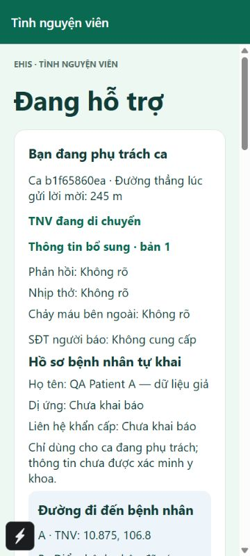

# EHIS 0.4.7 — nghiệm thu nhiều tài khoản, nhiều vùng và theo flow

Ngày 2026-10-24, giờ người thử Asia/Saigon. Ưu tiên Android miễn phí + web; iOS native hoãn đến khi có tài trợ. **Chưa nghiệm thu vận hành cấp cứu thật.**

## Phạm vi và kết quả có bằng chứng

| Lớp | Đã làm | Kết quả / giới hạn |
| --- | --- | --- |
| Logic/type/lint | 7 backend + 27 logic khác, mobile/web typecheck/lint | 34 bài đạt sau vòng UI; kiểm tra cuối và phát hành ghi tại lab note |
| Integration | 6 bộ cũ + đa ca/vùng + feed active SDK | 8 bộ đạt trên Emulator; không phải thử điện thoại |
| Mở rộng địa lý/ưu tiên | Thêm TOP5/DATELINE rồi chạy lại toàn bộ đa ca | 14 nhóm đạt, 215 tài khoản Auth giả, 181 lượt API |
| Client SDK thực | 35 lịch sử mới đẩy ca active ra khỏi trang đầu, disable/enableNetwork, revision mới, thu hồi quyền | Feed riêng giữ ca, nối lại lấy revision, mất quyền xóa dữ liệu/khóa thao tác |
| Browser local | Patient lưu hồ sơ giả không phone, QR, báo trước/bổ sung sau, TNV nhận/map/đến/kết thúc, mở lại với ca ngoài 30 mục | Đạt; profile/private UI đóng sau kết thúc; không lấy GPS thật |
| Browser quyền | Patient mở URL Volunteer, TNV pending/ứng tuyển, admin duyệt, TNV được duyệt mở admin | Tự về Patient; chưa duyệt không có sẵn sàng; sau duyệt mới có; TNV vẫn không có quyền admin |
| UI nhỏ | Người báo và TNV ở viewport 360px | Không tràn ngang ở màn đã đo; chưa thay thử font/thiết bị Android thật |
| Firestore cloud | Đọc lại metadata, thêm composite index vùng/timestamp | STANDARD, Singapore, freeTier=true; không đổi Rules/IAM/billing; query cloud sau deploy ghi riêng |
| Android 0.4.6 đối chứng | Artifact tải/xác minh đúng source/version/code/cloud/âm/quyền | FINISHED, SHA-256 84da76628ddd6e5dec4db928f709c7c8376948741c54c584e66484e77a315f61; chưa cài thiết bị, không có các sửa 0.4.7 |
| Android 0.4.7 / cloud bản mới | Sau build, deploy và artifact verification | Xem mốc thực tại LAB_NOTES/STATUS; không tự điền Đạt cho mốc chưa xảy ra |

## 14 nhóm mô phỏng

| ID | Tình huống | Kết quả |
| --- | --- | --- |
| GEO-101 | 110 Auth ở xa đứng trước một TNV ở gần trong thứ tự ID | Đạt sau sửa; fail trước sửa do giới hạn 100 toàn cục |
| ZONE-12 | 12 Patient ở 4 vùng báo gần đồng thời; TNV riêng từng vùng | 12 ca độc lập, đúng vùng/hồ sơ, không truy cập chéo |
| RACE-6 | 6 người báo quét/gửi cùng một thẻ | Một ca thắng; phiên khác bị chặn, không lộ mã ca |
| TOP5 | 8 TNV đủ điều kiện, khoảng cách khác nhau | Đúng 5 người gần nhất |
| DATELINE | Hai phía kinh tuyến 180° và tọa độ latitude ngoài phạm vi | Không bỏ phía còn lại; điểm không hỗ trợ bị chặn |
| RETRY-8 | 8 lần gửi cùng ID do mất ack/bấm lặp | Một ca; payload đổi cùng ID bị chặn; retry sau đóng không tạo ca mới |
| BUSY | Một TNV nhận hai ca cùng lúc; TNV khác nhận phần còn lại | Một ca active/TNV, không xem được private ca kia |
| CANCEL | Nhận và hủy đồng thời, 3 vòng | Một trạng thái hợp lệ, pointer thẻ/TNV nhất quán |
| REVISION | 3 cập nhật điểm + 3 báo cáo cùng lúc rồi retry | Revision không mất/trùng; không trộn phone/điểm; chỉ người nhận đọc |
| ELIGIBILITY | Trong/ngoài 5km, cũ/tương lai, bận, offline, pending, NaN, bệnh nhân tự nhận | Chỉ TNV đủ điều kiện được mời |
| PRIVACY | Cross-account GET, owner PATCH/DELETE, tự gán admin | Bị chặn |
| PURPOSE | Đối tượng đăng ký lưu lại, không tự approved/admin; token malformed | Đúng; guard thêm kiểm tra UID hợp lệ |
| NAT | 5 người chung mạng tranh phần hạn còn lại | Budget nguyên tử, không vượt giới hạn |
| CAPACITY | 1001 bản ghi ứng viên mới trong vùng | Báo vượt năng lực rõ, không ghi ca/pointer dở dang |

Các nhóm bao gồm nhiều assertion và nhiều ca; không coi số nhóm là số người dùng thật hoặc kiểm thử tải production. 215 tài khoản chỉ tồn tại trong Emulator. 5 tài khoản UI local khác được tạo riêng trong `.local/qa-ui-047.private.json`; không dùng chúng đăng nhập APK/cloud. Tài khoản cloud bàn giao vẫn theo repo riêng tư ở LAB_NOTES.

## Những lỗi đã sửa

- [#2](https://github.com/Hoangcamng03/EHIS-Next/issues/2): bỏ sót TNV gần sau 100 ID toàn cục. Query bbox 5km + timestamp mới ở Firestore rồi exact Haversine; tối đa 1000 ứng viên trong vùng, fail rõ nếu vượt. Index được quản lý trong repo. Không coi trần này là năng lực cam kết.
- [#3](https://github.com/Hoangcamng03/EHIS-Next/issues/3): pin ca active bằng owner pointer/listener riêng, merge chống trùng/lùi revision; quan sát approval để xóa ngay khi thu hồi. Giữ kiểm tra quyền backend và root UI.
- [#4](https://github.com/Hoangcamng03/EHIS-Next/issues/4): chặn auth object không UID ở Emulator. Không quan sát bypass token production; portable wrapper và probe cloud được kiểm tra riêng.
- UI: lịch sử thu gọn; ca active đưa lên đầu trước hướng dẫn cài/tài khoản; điểm B chỉ mở phần cập nhật khi cần; quản trị phân biệt chưa tải với tải xong không có đơn; bỏ thuật ngữ triển khai khỏi hướng dẫn người dùng.
- Dependency backend: body-parser 1.20.8 → 1.20.9 trong range tương thích, xử lý high đã phát hiện; không force downgrade Expo/Firebase.

## Các cổng vẫn mở

| Việc | Trạng thái | Việc tiếp theo |
| --- | --- | --- |
| Hiệu năng trên hạ tầng đích | Chưa nghiệm thu, [#5](https://github.com/Hoangcamng03/EHIS-Next/issues/5) | Tách cold/warm, mạng, ack/delivery; đo chứ không suy từ Emulator |
| Advisory dependency | Còn mở, [#6](https://github.com/Hoangcamng03/EHIS-Next/issues/6) | Rà runtime/tooling/upstream; mobile 10 high, web 4 high; backend sau patch 8 moderate/0 high theo npm, không phải các CVE cộng gộp độc lập |
| Hai Android thật | Chưa thử bởi nhóm | Theo [ACCEPTANCE_FLOW](ACCEPTANCE_FLOW.md), ghi model/APK/mạng/GPS/âm/rung và vòng độc lập |
| Push/khóa màn hình | Chưa có bằng chứng tiếp nhận nền | Không coi Firestore foreground là push; cần thiết kế/nghiệm thu riêng nếu vận hành cần nền |
| GPS/mốc cổng/tầng/phòng | Chưa nghiệm thu thực địa | Đi bộ thử an toàn; xác nhận điểm, lối vào; không coi pin GPS là xác nhận đến nơi |
| Vận hành ca thật | Bị chặn | Đầu mối y tế, TNV xác minh/đào tạo, SOP/dự phòng, rà dữ liệu/pháp lý/bảo mật và trách nhiệm |

Thời gian Emulator ghi nhận ở đợt 215 tài khoản: createIncident p95 3.574s/40 mẫu; acceptIncident 7.136s/19 mẫu; updateIncidentLocation 10.567s/4 mẫu; submitBystanderReport 11.943s/4 mẫu. Bao gồm các thao tác tranh chấp/đồng thời và kết quả bị từ chối trong metrics. Mẫu nhỏ, tài nguyên/mạng local; không phải số đo cloud hoặc SLA. Giả thuyết cần kiểm tra là counter IP và transaction cùng ca; chưa khẳng định nguyên nhân hoặc chấp nhận độ trễ cho ca thật.

## Ảnh — chỉ dữ liệu giả

[Cảnh báo khẩn](assets/trial-047/volunteer-alert.jpg) · [Đã gửi, chưa có người nhận](assets/trial-047/report-before-accept.jpg) · [Kết thúc](assets/trial-047/report-closed.jpg) · [Patient](assets/trial-047/patient-role-and-history.jpg) · [TNV sau duyệt](assets/trial-047/volunteer-approved.jpg) · [Quản trị hết đơn](assets/trial-047/admin-empty-after-review.jpg) · [TNV bị chặn quản trị](assets/trial-047/admin-denied-volunteer.jpg).

Rà Rules có phạm vi tại [SECURITY_RULES_AUDIT](SECURITY_RULES_AUDIT_2026_10_24.json); điểm audit không phải chứng nhận cả hệ thống.

## Mốc cloud đã xác nhận

Runtime 257185b, [CI 40076506537](https://github.com/Hoangcamng03/EHIS-Next/actions/runs/40076506537) SUCCESS. Backend health đúng 0.4.7/project; 32 tệp Hosting khớp build. Truy vấn vùng/index chạy được với ca giả thật: 1 TNV được mời, private trước nhận 403; nhận, báo không phone và replay, đổi điểm đúng chủ và replay, đến/kết thúc; private sau đóng 403 và mutation mới 400. Token thiếu/sai 401. Fixture OFF/no-active đã đọc lại server. Các call ở mẫu nhỏ warm này khoảng 103–280ms, không thay cho đo tải, cold start hoặc điện thoại. [Ảnh cloud 0.4.7](assets/trial-047/cloud-volunteer-047.jpg).
