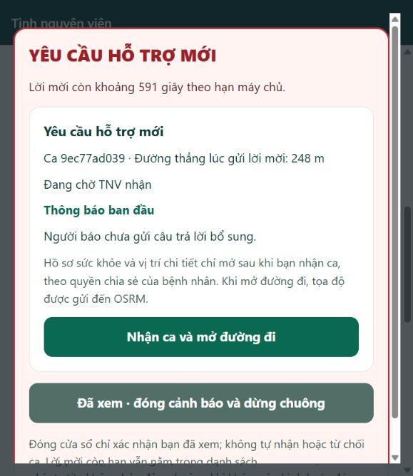
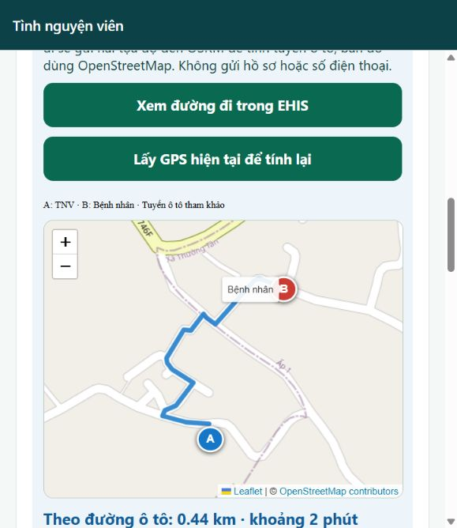
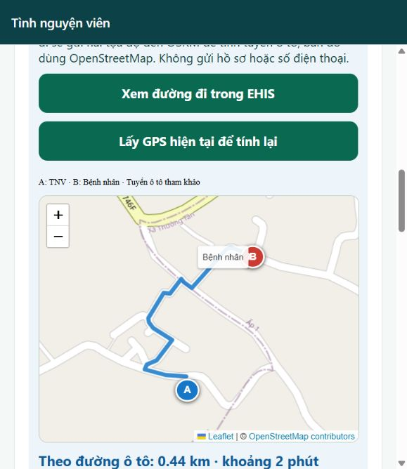

# Cảnh báo yêu cầu hỗ trợ cho Volunteer

Cập nhật theo source 0.4.9; phiên bản đã phát hành tra [STATUS](../STATUS.md). Kiểm chứng mới ở [VERIFICATION_V0_4_9](../testing/verification/VERIFICATION_V0_4_9.md); chưa xác nhận phần cứng Samsung/Android từ kiểm tra browser.

## Luồng để nhóm hiểu và chạy thử

1. Volunteer đăng nhập bằng tài khoản **cloud đã được duyệt**. Tài khoản Emulator không dùng trên web cloud; mật khẩu thử ở repo riêng tư được dẫn trong [lab note](../LAB_NOTES.md).
2. Bật công tắc **Sẵn sàng nhận yêu cầu hỗ trợ**, cho phép vị trí và đợi máy chủ xác nhận. UI hiển thị ĐANG SẴN SÀNG/CHƯA SẴN SÀNG/ĐANG PHỤ TRÁCH CA; không báo sẵn sàng chỉ vì vừa bấm nút.
3. Bấm **Bật và thử chuông · 1 giây**; người thử tự kiểm tra loa/âm lượng. Chọn rung nhẹ nếu trình duyệt hỗ trợ. Bật sẵn sàng cũng chuẩn bị audio trong thao tác người dùng, nhưng lỗi audio không chặn việc lấy GPS/gửi trạng thái.
4. Patient cấp QR. Người qua đường quét QR để mở web, xác nhận đang cạnh bệnh nhân và **bấm gửi yêu cầu**. Quét đơn thuần không tạo ca, không reo chuông.
5. Khi backend xác nhận ca và gửi lời mời hợp lệ cho TNV, web Volunteer ở phía trước hiện hộp cảnh báo đỏ, tình trạng quan sát, khoảng cách đường thẳng và hạn lời mời. Chuông mới tối đa **6 giây**, rung hai nhịp ngắn nếu thiết bị cho phép.
6. Người báo gửi bảng hỏi bổ sung: cùng ca cập nhật; mỗi revision mới phát chuông **2 giây** khi Volunteer đang theo dõi ca hoặc sẵn sàng. Snapshot lặp/metadata/kết nối lại cùng revision không reo lại trong cùng phiên.
7. Volunteer bấm **Nhận ca và mở đường đi**. Chỉ khi backend xác nhận nhận thành công mới mở chi tiết ở đầu trang. Hiện hồ sơ tự khai nếu Patient đồng ý chia sẻ; điện thoại người báo nếu có; bản đồ A→B và tuyến OSRM tự tính một lần sau thao tác nhận. Không tự báo đã nhận nếu có TNV khác nhận trước.
8. Xác nhận đã đến/kết thúc ca theo nút hiện có. Kết thúc làm đóng quyền xem riêng; muốn nhận ca mới cần bật sẵn sàng lại.

## Những chi tiết cần biết khi nghiệm thu

- Trước khi nhận: chỉ tình trạng quan sát và khoảng cách trong projection được cấp quyền. Không gửi bệnh án/vị trí chính xác/phone tới toàn bộ TNV. QR chỉ chứa mã thẻ, không chứa bệnh án.
- Hạn lời mời lấy từ backend, hiển thị đếm ngược gần đúng theo đồng hồ thiết bị. Không lấy bộ đếm 30 giây riêng để tự từ chối/đóng ca như một số mẫu UI cũ.
- **Đã xem · đóng cảnh báo và dừng chuông** chỉ đóng popup, không nhận/từ chối/hủy ca; lời mời còn hạn vẫn ở danh sách. Lời mời hết hạn hoặc người khác nhận sẽ đóng popup. Không dùng nháy màn hình liên tục.
- Từ 0.4.9 không có nút mute lâu dài khi nhận ca; **Dừng chuông hiện tại** chỉ dừng lượt này, không tắt chuông của lời mời sau. Android cần Media >0; Im lặng/Rung không đồng nghĩa Không làm phiền hoặc Media bằng 0. Rời trang, mất đồng bộ, tắt sẵn sàng hoặc hết ca sẽ dừng tín hiệu đang chạy khi không còn ca hoạt động.
- Phần vị trí của TNV được thu gọn sau nút **Xem vị trí tôi đã gửi**; bản đồ ca đang phụ trách được ưu tiên phía trên. Chi tiết ca có nút tải lại khi lỗi; khi chưa có bản đúng revision, không hiện hồ sơ/phone cũ như bản hiện tại. Bảng hỏi bổ sung không đổi tọa độ ca, nên giữ bản đồ/tuyến đã xác nhận trong khi tải phần bổ sung để không mất tuyến; mất đồng bộ hoặc đóng ca thì gỡ phần riêng.
- Tuyến đường trong EHIS dùng OSM/OSRM, không tính kẹt xe hoặc tự dẫn đường liên tục khi di chuyển. OSRM nhận hai tọa độ khi nhận ca và mở tuyến. Có nút tính lại và phương án mở Google Maps nếu dịch vụ lỗi. Xem [NAVIGATION.md](NAVIGATION.md).

## Giới hạn web và kế hoạch native

Chuông web cần tương tác người dùng để mở audio. Trình duyệt có thể treo trang/âm thanh khi chuyển tab, khóa màn hình hoặc tắt app; chức năng hiện tại chỉ nghiệm thu ở **trang đang mở phía trước**, không phải push nền. Khi quay lại trang, lời mời mới còn hạn được xử lý theo dữ liệu server; không hứa đánh thức điện thoại.

Vibration API không hoạt động trên mọi trình duyệt/thiết bị; có API cũng không chứng minh motor rung thực tế. iPhone/Safari không được hứa rung từ web. Thông báo UI không thay cho người kiểm tra loa/rung trên điện thoại.

APK đã có expo-audio/haptics foreground, không còn fallback cũ; trạng thái build/cài ở STATUS. 0.4.9 đợi WAV có hạn và tự chuẩn bị lại khi cảnh báo đến. Browser/adapter/build không chứng minh loa/rung Samsung thật hoặc push nền; nhóm phải thử máy. Chưa IPA/OTA/push nền.

Tài liệu nền tảng: [Web Audio và thao tác người dùng](https://developer.mozilla.org/en-US/docs/Web/API/Web_Audio_API/Best_practices), [Vibration API](https://developer.mozilla.org/en-US/docs/Web/API/Navigator/vibrate).

## Mã nằm ở đâu?

| Phần | File |
|---|---|
| Công tắc sẵn sàng/GPS | `frontend/app/src/components/VolunteerAvailability.tsx` |
| Hộp cảnh báo, nhận ca và thứ tự hiển thị | `frontend/app/src/app/volunteer.tsx` |
| Chính sách mới/cập nhật/chống reo lặp | `frontend/app/src/lib/alert-policy.ts` |
| Audio hữu hạn, dừng và âm lượng | `frontend/app/src/lib/emergency-audio.ts` |
| Browser audio/rung/visibility | `frontend/app/src/lib/use-emergency-signal.web.ts` |
| Dự phòng native chưa phát hành | `frontend/app/src/lib/use-emergency-signal.ts` |
| Tính tuyến sau nhận ca | `frontend/app/src/components/IncidentNavigation.tsx` |
| Kiểm thử hồi quy tín hiệu | `scripts/test-emergency-alerts.cjs` |

## Bộ bài thử

Kiểm tra: bật/tắt chỉ đổi sau xác nhận; từ chối GPS không báo sẵn sàng giả; quét QR chưa gửi không tạo cảnh báo; gửi mới hiện popup; cùng revision không reo lại; bổ sung mới phát 2 giây; dừng/mute hoạt động; lời mời hết hạn/người khác nhận đóng popup; nhận thành công mở map/profile đúng consent; mạng lỗi không lộ dữ liệu cũ như hiện tại. Thử thêm trình duyệt không hỗ trợ audio/rung và chuyển nền trên thiết bị thật.

Kết quả từng vòng được ghi riêng trong [LAB_NOTES.md](../LAB_NOTES.md). Unit test kiểm tra lịch phát và dedupe, không chứng minh loa/rung vật lý. Chỉ dùng tình huống và hồ sơ giả trong đợt thử có kiểm soát.

## Kết quả đã quan sát trên cloud

Source bản cuối: `b161a09a7d3de5695d97800396d1a359949a4d61`. Hosting đã phát; HTML và entry JavaScript khớp artifact. Backend vẫn 0.4.2, không đổi Rules/schema/quyền. [CI run 39823458878](https://github.com/Hoangcamng03/EHIS-Next/actions/runs/39823458878) đạt, gồm check/Android JS export/web build/năm suite integration.

| Bài thử | Kết quả |
|---|---|
| Thử chuông, mute/bật lại | Browser hiển thị trạng thái phát từ bộ audio; mute và bật lại đúng. Chưa xác nhận âm nghe/rung bằng máy thật |
| Sẵn sàng và công tắc OFF | ON được seed qua API bằng tọa độ giả; OFF thao tác trên UI, đọc server xác nhận false mà không ghi đè kết quả. Chưa nghiệm thu bật GPS trên điện thoại trong đợt này |
| Tạo yêu cầu mới | Backend mời đúng 1 TNV; popup hiện và UI báo đang phát chuông; private API từ chối trước nhận |
| Bổ sung trước nhận / gửi lại cùng ID | Revision 1 được cập nhật; replay vẫn revision 1. Dedupe/lịch 6s–2s có kiểm thử tự động |
| Nhận ca | Popup đóng, chi tiết lên đầu, phone không bắt buộc, chỉ hồ sơ giả theo consent; OSRM tự tính 0,44 km/khoảng 2 phút |
| Bổ sung sau nhận | Thông tin mới về đúng ca; tuyến 0,44 km vẫn hiện, không phải bấm tính lại |
| Đến nơi và kết thúc | Trạng thái cập nhật; UI gỡ private/map; backend từ chối đọc sau đóng |
| Trạng thái cuối | Hai ca thử đã đóng; tài khoản bàn giao Volunteer không sẵn sàng, chuông được bật lại để nhóm thử tiếp khi chủ động bật sẵn sàng |

Ảnh dưới đây chỉ có tình huống, tọa độ và tài khoản giả; không có mật khẩu/token. Bộ ảnh theo bước đầy đủ ở `.local/volunteer-alarm-proof/`, Git bỏ qua.

## Nhiều ca và TNV bật muộn — từ 0.4.9

Bật ON tìm lại ca gần còn hạn, không cần người báo gửi lần nữa; không gia hạn ca hoặc mời Patient tự nhận. Lời mời đọc riêng khỏi 30 mục lịch sử. Hàng đợi ở trên cài đặt, chọn ca khác trong popup hoặc Xem tất cả ca chờ; mở ca theo hạn trước rồi khoảng cách, không tự phân loại y khoa. Khi đang phụ trách, nút nhận ca khác bị khóa. Xem API_CONTRACT về giới hạn pilot 100 ca chờ, 20 người mời/ca và feed 100 có cảnh báo vượt giới hạn.
