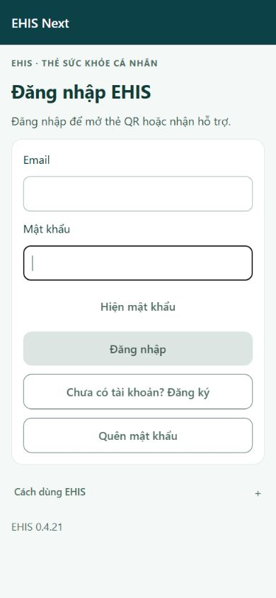
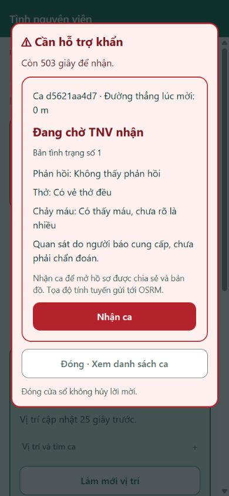
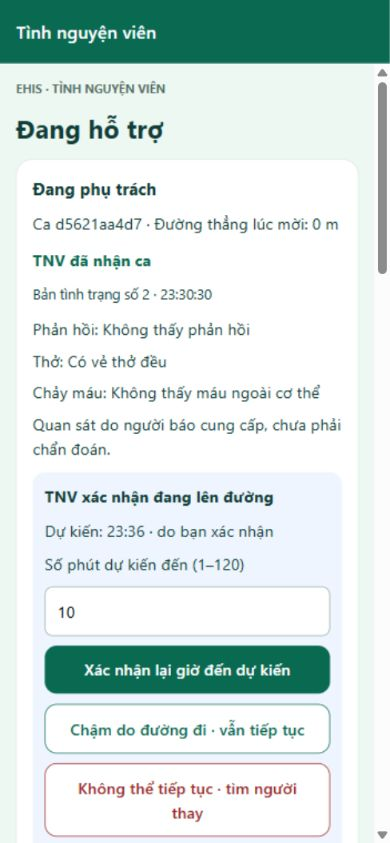
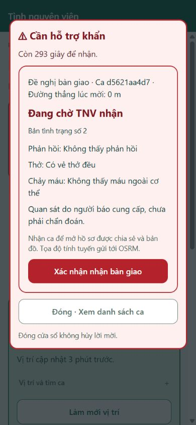
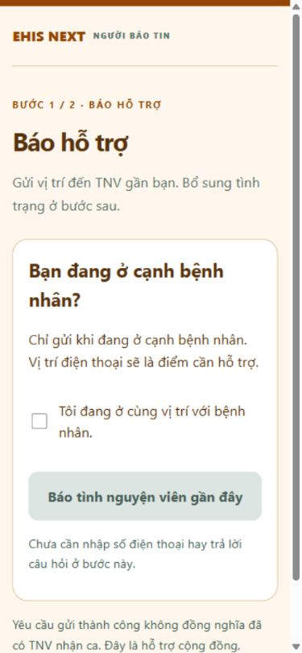
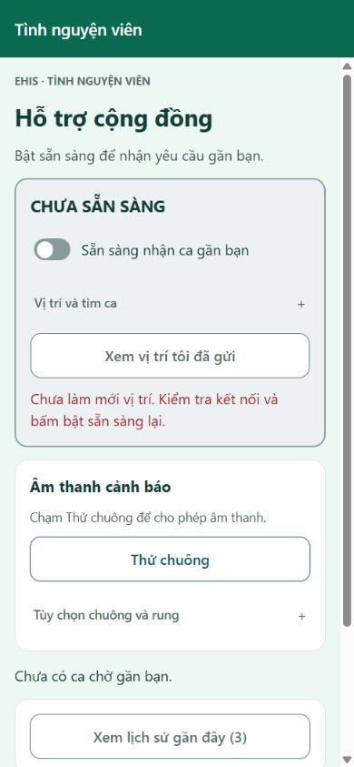
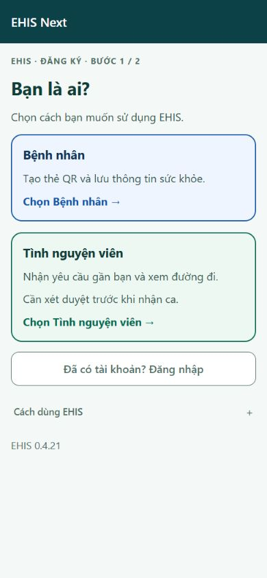
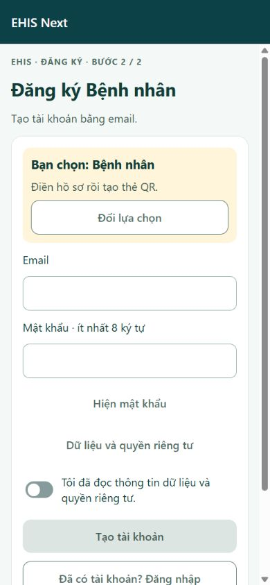
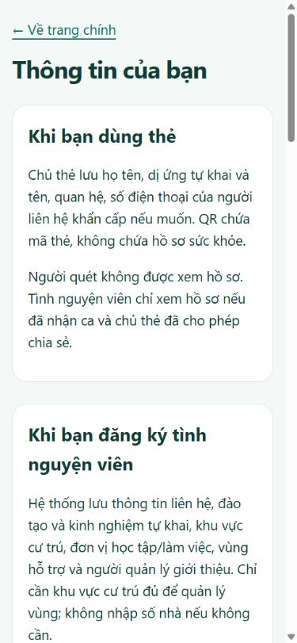

# UAT cloud với hồ sơ hư cấu ngày 11 tháng 11 năm 2026

[Bằng chứng số](CLOUD_UAT_2026_11_11.json) · [Lab note](../../LAB_NOTES.md) · [Tài khoản riêng](https://github.com/Hoangcamng03/EHIS-Next-Team-Access/blob/main/accounts/UAT_CLOUD_2026_11_11.md).

## Kết luận

Đạt luồng phối hợp điện thoại người báo và TNV web trên Firebase thật: gửi ca, bổ sung, nhận ca, ETA, bản 2 và xác nhận tải, bàn giao, hoàn tất và thu quyền. Chưa đủ bằng chứng chốt bản cuối cho vận hành cấp cứu thật. Hồ sơ là hư cấu; số liệu kết quả là quan sát thực.

## Bộ dữ liệu mới

6 bệnh nhân: hen/dị ứng Penicillin; đái tháo đường; động kinh/dị ứng Latex; tăng huyết áp; tiền sử mạch vành/dị ứng Aspirin; không khai bệnh nền. Hai hồ sơ không chia sẻ. 2 TNV đã duyệt fixture, 1 TNV chờ. Không thêm admin hoặc người giới thiệu. Mọi tên/kinh nghiệm/liên hệ là hư cấu; số toàn số 0, không gọi. Credentials và QR hoạt động chỉ lưu riêng.

## Kiểm tra và sửa

- 88 bài kiểm tra/lint/typecheck đạt; 17 nhóm kiểm thử toàn luồng đã chạy trong phiên trước cùng ngày, không gọi là đã chạy lại 17 nhóm kiểm thử sau sửa link/map.
- Cloud API: 2 ca biệt lập, lời mời/nhận đồng thời chỉ một thắng (HTTP400/200), chống lặp, quyền (HTTP403), không ứng viên giữ ca, bật sẵn sàng muộn; đọc lại 3 TNV đều tắt Sẵn sàng, không có ca đang phụ trách.
- Điện thoại gửi Minh An/bảng hỏi thật; backend đọc lại completed, bản tình trạng 2 và bàn giao accepted; hai TNV cũ/mới đọc ca đóng đều trả HTTP403. Chủ máy xác nhận tiến độ, gửi cập nhật, trang cuối không nhận thêm. TNV dùng vị trí API đặt theo điểm ca; không ghi GPS thật TNV. Không xác nhận đã đến hiện trường.
- Sửa nút QR/privacy thành liên kết web trực tiếp, đã bấm mở đúng đích cloud. Native giữ Linking.
- Map khởi tạo lỗi trong tab cũ sau phát hành; reload khôi phục. Sửa nút trước chỉ thử lại tile thành lựa chọn tải lại ứng dụng khi khởi tạo lỗi; không tự reload ca. Rủi ro tab cũ/cập nhật khi ca hoạt động còn cần kiểm thử sâu.
- Bổ sung bệnh nền/tiền sử vào mô tả privacy cho khớp dữ liệu thực sự lưu.

## Bảng nghiệm thu và phần còn mở

| Trạng thái | Hạng mục | Bằng chứng / giới hạn |
| --- | --- | --- |
| PASS | Người báo gửi qua điện thoại → TNV web nhận/cập nhật/bàn giao/kết thúc | Firebase thật và xác nhận chủ máy; vị trí TNV chuẩn bị qua API |
| PASS | Sau đóng ca, hai TNV không còn quyền xem chi tiết | API trả HTTP403 |
| FAIL | Trình duyệt PC lấy GPS | Không lấy được; không tạo ca giả để gọi là đạt |
| CHƯA THỬ | Độ chính xác GPS điện thoại, GPS di chuyển | Điện thoại gửi được chưa chứng minh sai số hoặc di chuyển |
| CHƯA THỬ | APK21/chuông nền/máy thật ở lượt UAT này | Không có kết nối USB; chưa thử lại lỗi tự thoát |
| CHƯA THỬ | Hiệu suất Functions sau sửa | Kết quả cũ 21 866 ms vượt 15 000 ms còn cần đo lại |
| CHƯA THỬ | Mọi nhánh lỗi khởi tạo bản đồ | Đã thấy reload phục hồi, chưa phủ hết nhánh lỗi |
| CHƯA THỬ | Tải lớn trên cloud | Chỉ kiểm tra số ca có giới hạn |
| CHƯA THỬ | Chụp trực tiếp màn người báo trên điện thoại | Đã xác minh người dùng/backend, chưa có ảnh máy thật |

Không biến bước chưa thử thành PASS. Bộ ảnh gồm các giai đoạn cloud đã quan sát; form đăng ký được chụp minh họa giao diện,9 tài khoản mới được tạo/kiểm tra qua Auth/API. Các ảnh QR hoặc có thể hiện bản đồ vị trí thực giữ riêng trên máy, không đưa lên repo public. Ảnh mobile web viewport390×844, không phải ảnh APK.

## Ảnh có thể chia sẻ

Ảnh dùng khung mobile web 390 × 844, không phải ảnh APK. Số Hình được đánh lại liên tục để trình bày; tên file giữ mã ảnh gốc của phiên chụp. Đây là tuyển ảnh public nên mã file không liên tục; không coi ảnh không xuất hiện là bài đã nghiệm thu.

### Hình 1 · Đăng nhập (mobile web)

### Hình 2 · Lời mời từ thông tin người báo (mobile web)

### Hình 3 · Tình trạng cập nhật lần 2 (mobile web)

### Hình 4 · Bàn giao ca (mobile web)

### Hình 5 · Liên kết mở trang từ QR (mobile web)

### Hình 6 · Ca đã kết thúc (mobile web)

### Hình 7 · Chọn đối tượng đăng ký (mobile web)

### Hình 8 · Biểu mẫu đăng ký (mobile web)

### Hình 9 · Liên kết quyền riêng tư (mobile web)

