# Kiểm thử flow và bộ ảnh ngày 11 tháng 11 năm 2026

[Lab note](../../LAB_NOTES.md) · [Bằng chứng](FLOW_REVIEW_2026_11_11.json) · [Mở bộ ảnh dạng gallery](../../assets/flow-2026-11-11/index.html).

Ảnh thật từ trình duyệt, dữ liệu và vị trí giả trong Emulator local. Màn app/người báo 390 × 844; người giới thiệu/quản trị 1280 × 900. Đây là ảnh mobile web, chưa phải ảnh APK hoặc GPS trên điện thoại thật. Tài khoản/QR trong ảnh chỉ dùng local.

## Kết quả kiểm tra

- Đạt: Patient signup routes automatically; profile save and consent QR creation
- Đạt: Volunteer signup/application, pending referral then pending admin
- Đạt: Referral incomplete checklist disables recommendation; saved checklist persists after reload
- Đạt: Admin confirmation cancel and approve; app unlocks readiness without auto ON
- Đạt: Synthetic position readiness; bystander confirmation creates incident before questionnaire
- Đạt: All three answers required; optional phone empty accepted; report revision2 restored after reload and acknowledged by app
- Đạt: Accepted case private profile and route render
- Đạt: Going/ETA reflected on reporter; overdue did not close case
- Đạt: Cannot continue invites backup; explicit handover frees former owner
- Đạt: Arrival and completion confirmations; reporter terminal form removed; both volunteers OFF

88 bài kiểm tra mã và 17 suite liên thông đạt (330205ms). Lượt đầu lỗi khởi động Emulator do quyền Windows; giữ FAIL, lượt chạy đủ quyền mới PASS. Đã sửa hai câu: công tắc chia sẻ bổ sung bệnh nền; trang người báo không còn nhắc phải xác nhận lên đường khi TNV đã lên đường. Chỉ sửa source local, cloud/APK vẫn bản đã phát trước lượt này.

## Đối chiếu tài liệu HIC được cung cấp

BME10_Full-text__292.docx là tài liệu tham khảo, không phải kết quả EHIS. Giữ các mục có thể đối chiếu: QR liên kết hồ sơ, bệnh nền/dị ứng/liên hệ, nhận ca duy nhất và giao tiếp người báo–TNV. Không chuyển stack sang .NET MAUI hoặc thêm điều phối xe cứu thương vì khác phạm vi đã thống nhất.

MARS 4.08/15 người là số liệu của tài liệu, không được đưa vào báo cáo nghiệm thu EHIS. 2FA, mã hóa đầu cuối/tầng ứng dụng, xác minh giấy tờ, thuốc đang dùng và hiệu quả giảm thời gian cấp cứu chưa được chứng minh ở EHIS; ghi thành khoảng trống phát triển. Nên tổ chức UAT riêng với người tham gia thật, thu kết quả từng câu, không tự tạo điểm MARS.

## Phần chưa kết luận

- Actual APK21/physical GPS/movement/audio/vibration/background/offline independent
- Every external link popup destination: privacy/Mở trang từ QR popup not visibly captured in IAB
- Real clinical effectiveness, 2FA or end-to-end encryption claims from supplied paper

## Ảnh theo thứ tự

### 01 Đăng nhập

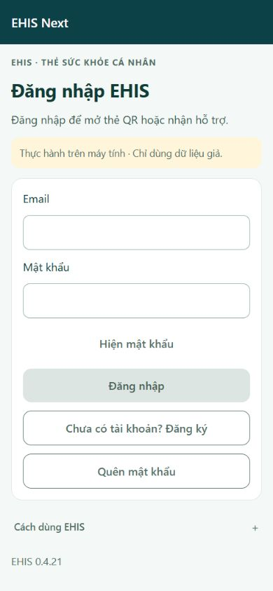

### 02 Chọn đối tượng

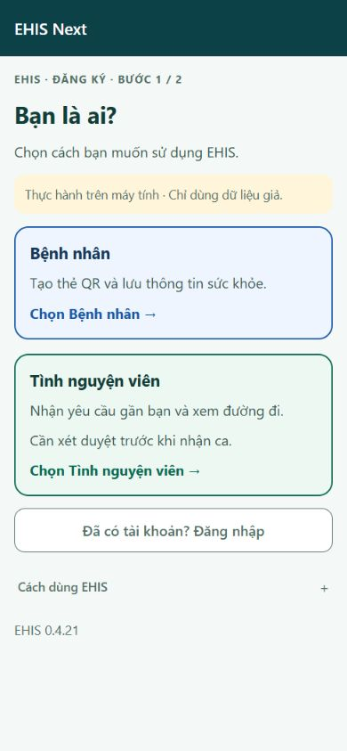

### 03 Đăng ký bệnh nhân

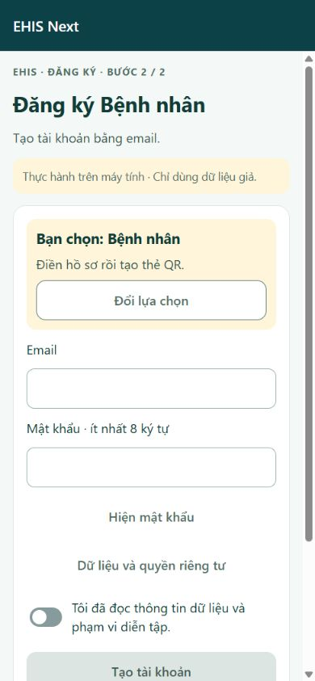

### 04 Hồ sơ bệnh nhân

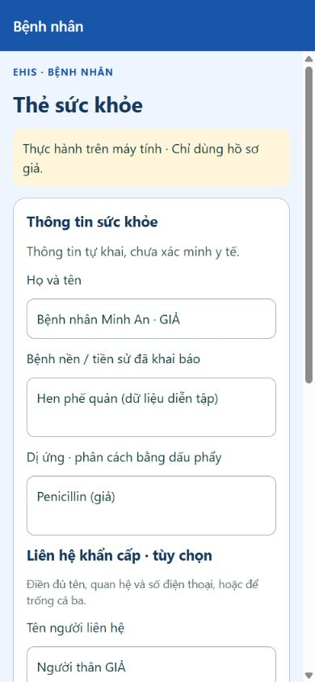

### 05 Thẻ QR

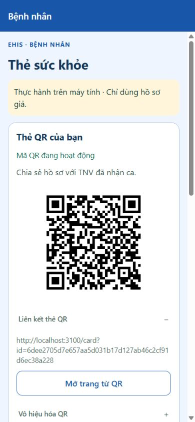

### 06 Xác nhận vị trí giả

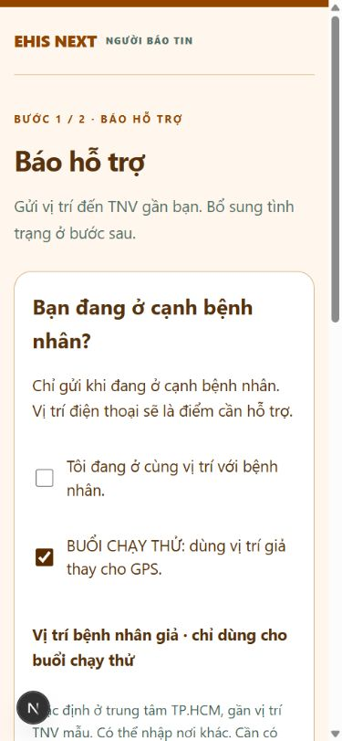

### 07 Hồ sơ TNV

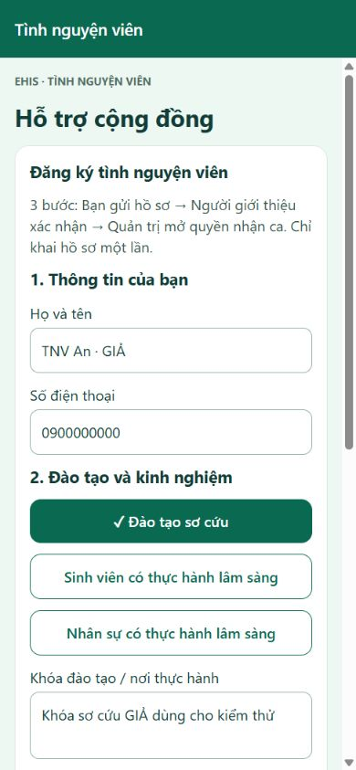

### 08 Chờ người giới thiệu

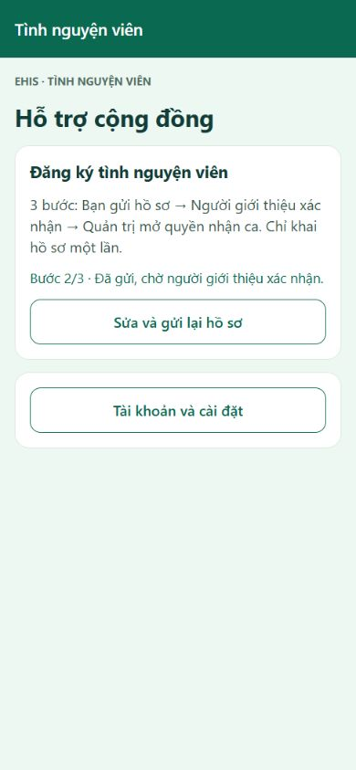

### 09 Checklist người giới thiệu

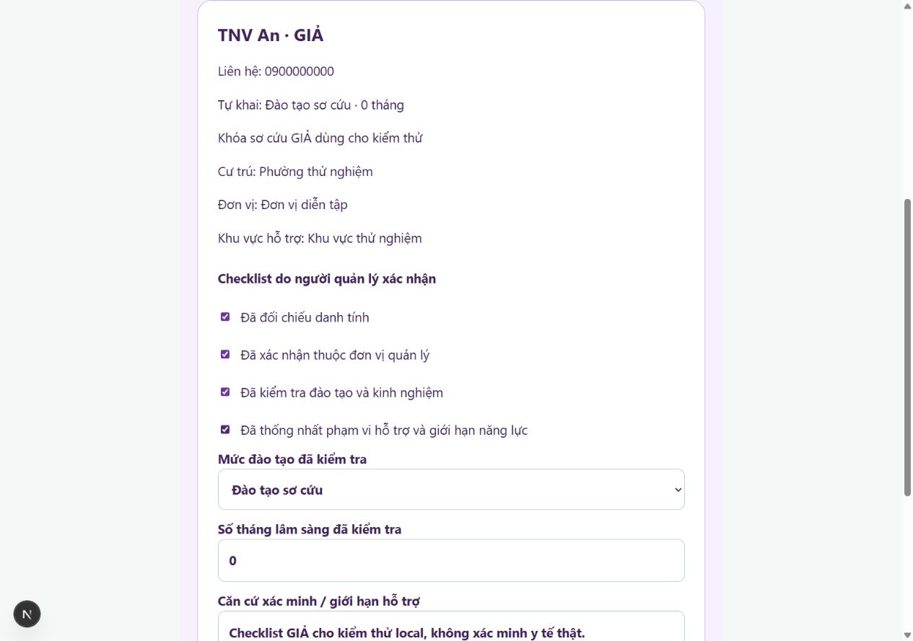

### 10 Quản trị xét duyệt

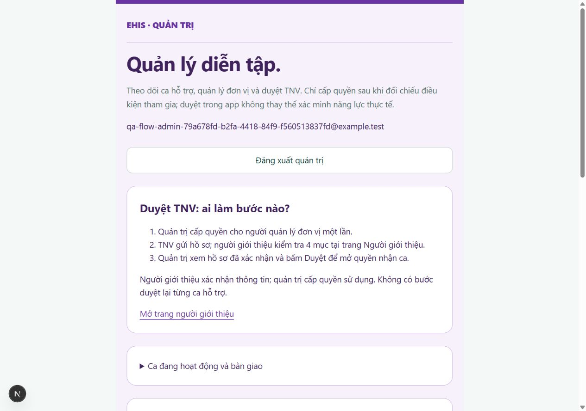

### 11 TNV sẵn sàng

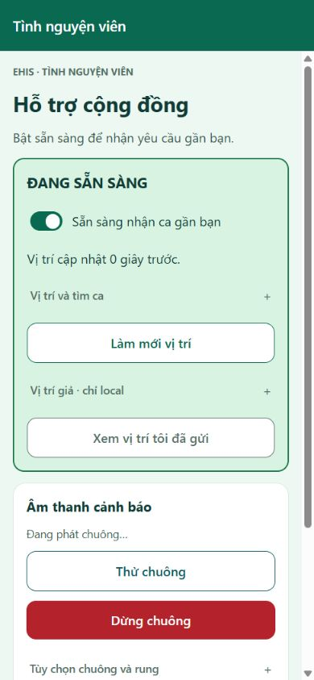

### 12 Bảng hỏi người báo

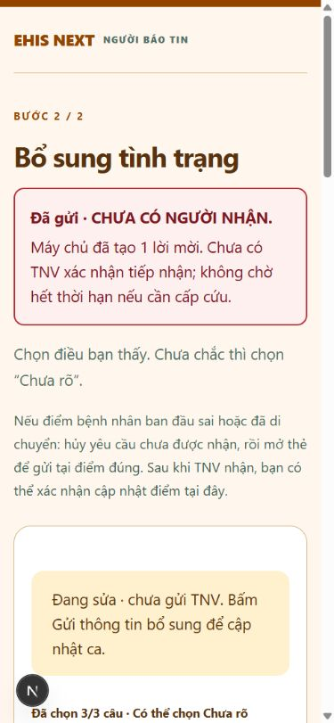

### 13 Cảnh báo ca mới

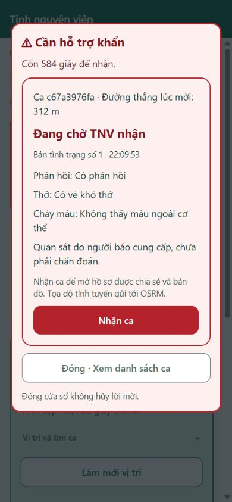

### 14 Tiến độ lên đường

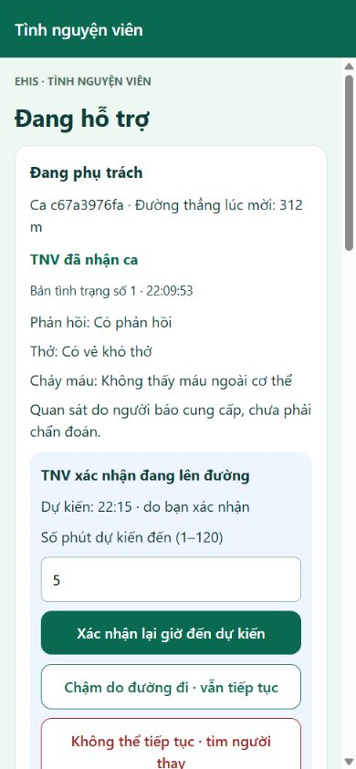

### 15 Hồ sơ được chia sẻ

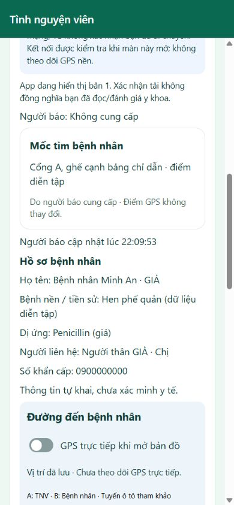

### 16 Bản đồ và tuyến đường

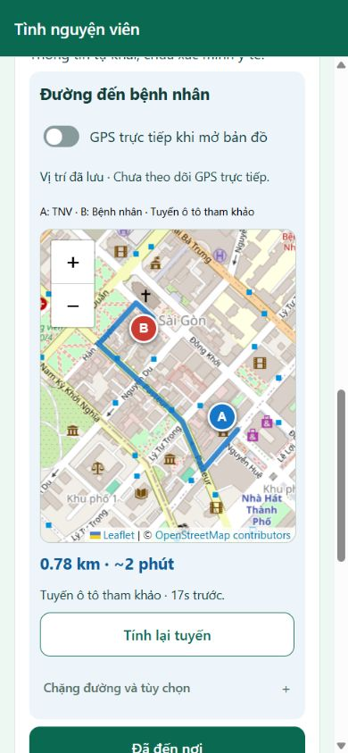

### 17 Lời mời bàn giao

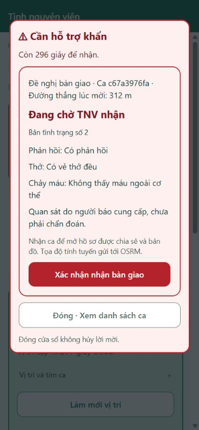

### 18 Xác nhận hoàn tất

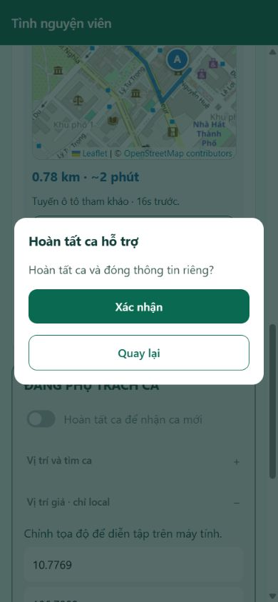

### 19 Người báo thấy kết thúc

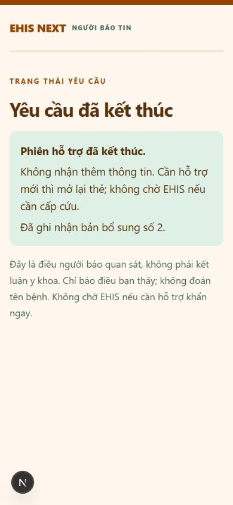

### 20 Người cũ được giải phóng

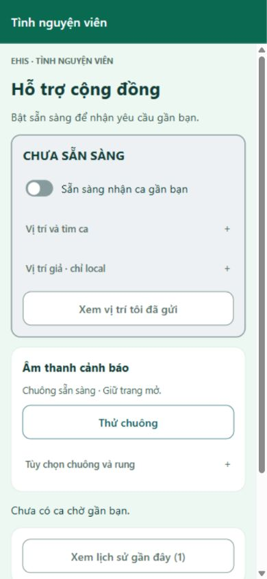

