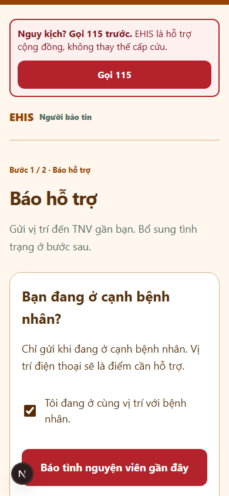
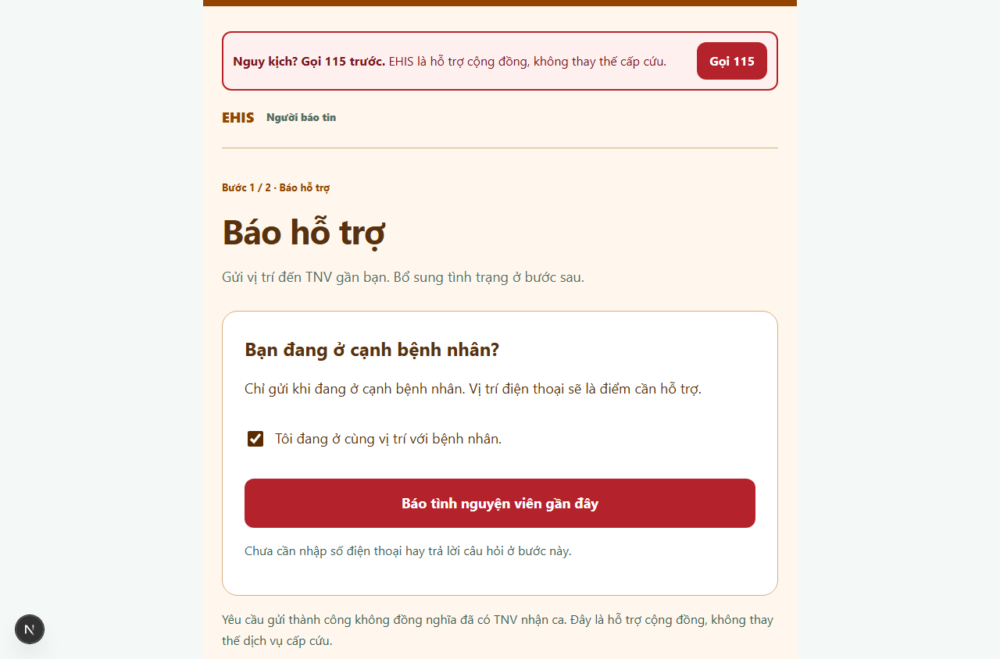
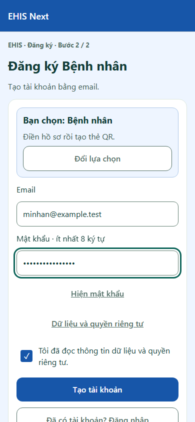
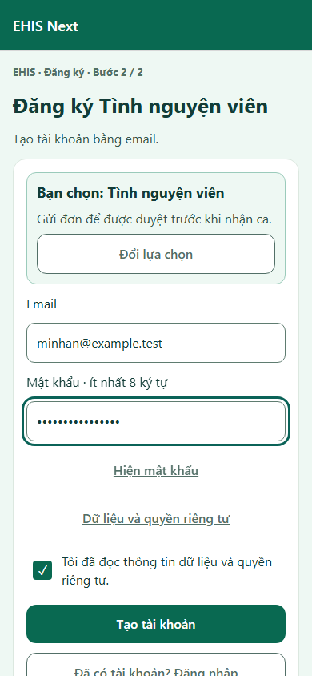
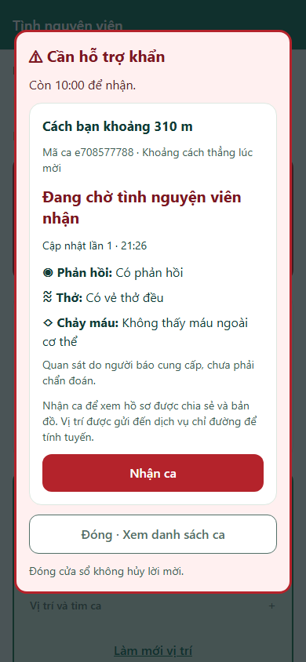
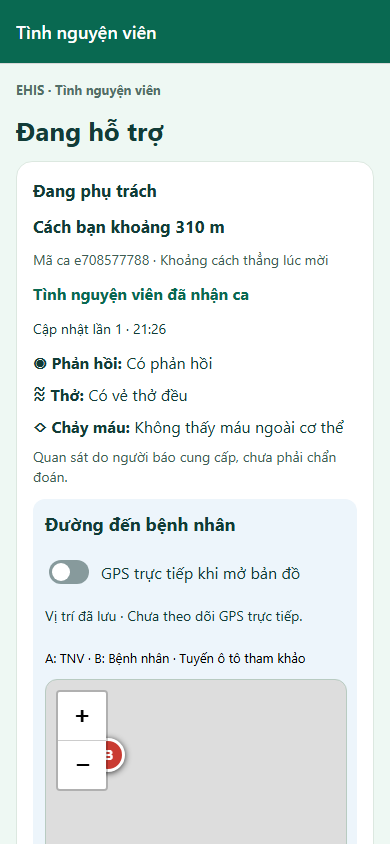

# EHIS — đối chiếu góp ý và bản cải thiện 12/11/2026

[Danh mục](../../README.md) · [Lab note](../../LAB_NOTES.md) · [Trạng thái phát hành](../../STATUS.md)

Phạm vi: sửa source, kiểm thử local với dữ liệu và tọa độ chủ động. Kết quả trình duyệt không thay cho nghiệm thu APK, GPS di chuyển hoặc hoạt động y tế. Những giới hạn có thật vẫn phải hiển thị rõ; giao diện không chứa công cụ hoặc nhãn chạy thử.

## 1. Góp ý nào hợp lý và đã xử lý thế nào?

| Ưu tiên | Góp ý | Xử lý và phạm vi |
| --- | --- | --- |
| Cao | Người báo cần đường gọi cấp cứu | Thêm dải gọi `tel:115` ở trang thẻ và bảng hỏi, cả trạng thái tải/lỗi/kết thúc. Giữ EHIS là luồng báo TNV. Đây là yêu cầu mới thay cho lựa chọn trước không có nút 115. Không tự gọi hoặc dùng 115 để thử. |
| Cao | Cảnh báo có chữ kỹ thuật thô | Đếm ngược phút:giây; khoảng cách làm tròn, mã ca xuống dòng phụ; giờ cập nhật chỉ giờ:phút; giải thích dịch vụ chỉ đường bằng từ phổ thông. Khoảng cách vẫn được ghi là đường thẳng lúc mời, không giả là đường đi hoặc GPS hiện tại. |
| Cao | Đỏ vừa nhận vừa hủy | Đỏ cho cảnh báo/yêu cầu khẩn; hành động không thể tiếp tục dùng xám và xác nhận. Bỏ viền đỏ của thẻ bên trong modal. Quan sát dùng nhãn đậm/biểu tượng, không suy diễn mức nguy hiểm từ màu. |
| Cao | IP proxy dùng chung bộ đếm | Backend lấy `x-vercel-forwarded-for` khi chạy trên Vercel; local/Functions dùng IP kết nối. Kiểm tra IP hợp lệ; không tin header tùy ý trên local, không bật `trust proxy=true`. Nếu header Vercel thiếu/sai thì giữ giới hạn theo tài khoản, không gộp mọi người vào IP proxy. Đã có test tách hai địa chỉ giả định; chưa có xác minh cloud bằng hai mạng thật. |
| Cao | Đổi tài khoản ẩn danh né giới hạn | Thêm tối đa 6 yêu cầu mới/thẻ trong cửa sổ trượt 60 phút, ghi cùng transaction tạo ca. Yêu cầu trùng/retry không dùng thêm lượt. Lưu tối đa 6 mốc trên card backend-only, không thêm lần đọc/ghi bộ đếm riêng mỗi request. Hết giới hạn phải báo rõ và vẫn có nút gọi cấp cứu. Đây là mức bảo vệ cho nhóm nhỏ, không chống được mọi lạm dụng hoặc việc kẻ xấu chiếm lượt của thẻ. |
| Cao | Token admin cũ còn quyền | Các API quản trị đối chiếu tài khoản Auth hiện hành: admin claim còn hiệu lực và tài khoản không bị khóa. Thu hồi claim chặn API ngay cả khi token cũ chưa làm mới. Chi phí: thêm một lần đọc Auth cho thao tác quản trị; không thêm vào mọi thao tác TNV. |
| Cao | App Check | Thêm điểm cấu hình App Check cho hai bản web và ví dụ biến môi trường. **Chưa bật cưỡng chế**: cần đăng ký key/domain, kiểm tra provider/hạn mức, theo dõi request rồi tích hợp attestation native và nghiệm thu APK đang dùng. Không gọi SDK web trên native, không tự bật billing. |
| Cao | Bỏ ngưỡng 1.000 ứng viên | **Không áp dụng cách cắt 1.000 đầu tiên.** Truy vấn hiện sắp theo vĩ độ/kinh độ, không theo khoảng cách. Cắt sẽ bỏ sót người gần nhất và có thể che tình trạng quá tải. Giữ từ chối rõ ràng; thiết kế geohash/chia ô và đo tải trước khi mở rộng. Không coi tăng tùy tiện giới hạn đọc là tối ưu miễn phí. |
| Cao | Worker thông báo và GPS nền | Giữ OPEN: chưa có worker cam kết thời gian, chưa có GPS nền. Điểm quá 5 phút không được chọn; giao diện đã có cảnh báo cũ và yêu cầu làm mới. Không nói “đang sẵn sàng” đồng nghĩa luôn được mời khi khóa máy lâu. Lỗi tự thoát/GPS di chuyển cần điện thoại thật. |
| Trung bình | Form đăng ký/đăng nhập | Màu thông tin và thanh đầu theo vai trò ở bước 2. Đồng ý dùng ô tick; link/nút chữ có gạch chân. Thêm lý do nút bị khóa, khóa mật khẩu dưới 8 ký tự khi đăng ký; quên mật khẩu là nút chữ dưới ô mật khẩu. Phiên bản nằm trong Thông tin ứng dụng. |
| Trung bình | Màn TNV quá nhiều nút ngang trọng lượng | Công tắc Sẵn sàng có vùng nhấn lớn và nền đổi khi bật; trạng thái dùng chữ thường/chấm. Các tiện ích vị trí/chuông/lịch sử dùng kiểu nhẹ. Đường đi và Đã đến nơi đặt trước tiến độ; hồ sơ bệnh nhân thu gọn, Không thể tiếp tục rút nhãn và tách khoảng cách với nút chính. |
| Trung bình | Nhãn nhỏ/viền/focus | Nhãn phụ web từ 13 px, bỏ giãn chữ nhỏ; nhãn bước người báo dùng chữ thường. Viền nhập app/web đậm hơn; focus web có màu đủ tương phản. Giữ phóng chữ hệ thống và vùng nhấn tối thiểu 48. |
| Trung bình | Danh sách API bị quên cập nhật | Loại bỏ danh sách lặp viết tay; server tự nhận đúng các export callable từ metadata Firebase. Test đối chiếu toàn bộ export, loại health/scheduler khỏi API callable. |
| Trung bình | Rules thiếu test riêng | Thêm `@firebase/rules-unit-testing` với project riêng `demo-ehis-rules`, 11 bài kiểm tra owner, anonymous, đọc chéo, quyền admin trên client, sửa quyền và truy vấn. Rules không bị nới quyền. Chưa coi đây là audit toàn hệ thống. |
| Trung bình | Lệnh check khó đọc/code dài | Chuyển sang runner có tên bước và kết quả/timing riêng. Thêm Prettier rộng 100, định dạng các file đang sửa. Không áp max-len cứng lên đoạn tiếng Việt/URL. Chưa định dạng lại mọi file lịch sử hoặc tách toàn bộ transaction trong cùng đợt sửa bảo mật. |
| Trung bình | Trùng hợp đồng app/web | Kiểm tra hai bản travel-progress phải giống nhau và giữ test tương thích observations. Góp ý report-status trùng ở app **không đúng checkout này**: chỉ web có file đó. Chưa đổi cả monorepo sang npm workspaces vì ảnh hưởng đường build/EAS. |
| Trung bình | Chưa có UI test | Thêm Playwright: trang người báo ở 390/1280 px, axe WCAG A/AA, hai form vai trò, đăng ký Patient tự định tuyến, luồng gửi → nhận → cập nhật → đóng ca. Điểm tọa độ do trình duyệt kiểm thử cấp; TNV được duyệt bằng fixture, không nhận là đã thử quy trình xác minh ngoài đời. |
| Thấp | Repo có nhiều ảnh | Đo hiện tại: 242 file docs, khoảng 12,1 MB trước bộ ảnh mới; số lượng file chưa đủ kết luận repo quá nặng. Giữ bằng chứng/liên kết cũ; các gói ảnh lớn về sau đưa vào artifact/Release có kiểm tra quyền và nội dung. Không đổi lịch sử Git, không chuyển hàng loạt sang LFS làm hỏng link. |

## 2. Giới hạn miễn phí: điều gì không tự giải quyết bằng code?

- **Vercel Hobby:** cron chỉ một lần/ngày và thời điểm không chính xác. Workflow GitHub đã chuẩn bị chạy vào phút 7/17/27/37/47/57, tránh đầu giờ, có khóa tránh chạy chồng và xác thực secret. **Mặc định chưa bật** khi chưa có biến/secrets. GitHub schedule có thể chậm/bỏ lượt và tự tắt sau thời gian repo không hoạt động; không dùng làm đường bảo đảm thông báo khẩn.
- **Firestore Spark:** TTL managed deletes không nằm trong quota miễn phí, cần bật billing. Không bật Blaze để làm theo góp ý TTL. Code bảo trì đã dọn `_requestLimits` theo expiresAt; `expiresAt` tự nó không tự xóa dữ liệu. Giới hạn theo tài khoản/IP vẫn dùng Firestore; bỏ ngay bộ đếm này sẽ mất bảo vệ khi App Check/WAF chưa được xác minh.
- **App Check:** thêm SDK/key chưa đồng nghĩa đã được bảo vệ. Cần đăng ký app, quota provider và hỗ trợ mọi client đang cài trước khi cưỡng chế. Không công khai debug token.
- **Android:** giới hạn của Im lặng/Không làm phiền, pin, Home/khóa và tự thoát phải đo trên máy. Web/CI không chứng minh những phần này đã đạt.
- **Pháp lý/chuyên môn:** tài khoản cloud miễn phí không miễn nghĩa vụ dữ liệu cá nhân. Chưa có đầu mối y tế trực và người chịu trách nhiệm chuyên môn; không gọi bản này là đủ điều kiện cấp cứu công khai.

## 3. Bật lịch bảo trì khi nhóm sẵn sàng

1. Chủ repo vào GitHub → Settings → Secrets and variables → Actions.
2. Đặt variable `EHIS_BACKEND_URL` bằng origin HTTPS Vercel của backend, không có `/api` ở cuối.
3. Đặt secret `EHIS_CRON_SECRET` khớp secret bảo trì backend, không dán vào Issue, code hoặc lab note.
4. Đặt variable `EHIS_MAINTENANCE_ENABLED=true`; chạy workflow thủ công một lượt, kiểm tra bảng vận hành có thời điểm/kết quả mới.
5. Nếu lỗi hoặc tồn đọng: tắt variable, kiểm tra lỗi xác thực, quota và kết quả `partial`; quản trị dùng chức năng bảo trì trong web. Không ghi PASS chỉ vì workflow đã được tạo.

## 4. Dữ liệu, thu quyền và xử lý yêu cầu xóa

| Nhóm | Cách xử lý hiện tại | Việc còn thiếu trước dữ liệu người thật |
| --- | --- | --- |
| GPS/phone/câu trả lời riêng của ca | API chặn quyền sau khi đóng; đặt hạn dọn sau 24 giờ, worker dọn theo đợt, bảo vệ ca đang xử lý | Đầu mối kiểm tra việc xóa, xử lý tồn đọng và thời hạn vận hành được duyệt |
| Bộ đếm truy cập | Hạn dữ liệu khoảng một giờ; bảo trì xóa theo expiresAt | Theo dõi quota và lượng backlog |
| Hồ sơ Patient/TNV | Không tự xóa theo ca; chủ thẻ sửa/thu hồi QR | Quy trình xác minh chủ thể, thời hạn lưu, xóa tài khoản và trường hợp cần giữ hồ sơ |
| Metadata ca/audit/tiến độ | Vẫn được lưu, không nằm trong phần private purge | Chốt lịch lưu/xóa có người phụ trách; chưa tuyên bố tuân thủ đầy đủ |
| Admin | Bỏ admin custom claim, khóa tài khoản nếu cần và thu hồi refresh token qua người vận hành; API kiểm tra quyền hiện hành | Kiểm tra lại trên cloud sau thay đổi quyền, thông báo cho người vận hành tiếp quản |

Yêu cầu xóa: tiếp nhận qua nhóm quản lý → xác minh chủ tài khoản bằng phiên đăng nhập/kênh đã đăng ký → liệt kê dữ liệu liên quan và ca đang mở → người được phân quyền xử lý theo chính sách đã duyệt → kiểm tra Auth, hồ sơ, card, dữ liệu riêng và projection → ghi nhật ký tối thiểu không chứa bệnh án. Không xóa hàng loạt khi chưa xác minh người yêu cầu hoặc đang có ca cần bàn giao.

Ngày 12/11/2026, không nên chỉ dựa vào Nghị định 13/2023: [Luật Bảo vệ dữ liệu cá nhân 91/2025/QH15](https://vanban.chinhphu.vn/?classid=1&docid=214590&pageid=27160&typegroup=) có hiệu lực từ 01/01/2026. Nhóm cần người có chuyên môn rà soát văn bản đang áp dụng, đồng ý xử lý dữ liệu sức khỏe, quyền chủ thể và chuyển dữ liệu ra nước ngoài. Tài liệu kỹ thuật này không phải kết luận tuân thủ pháp luật.

## 5. Nguồn kiểm tra chính thức

- [Vercel request headers](https://vercel.com/docs/headers/request-headers): header IP tại ingress.
- [Vercel Cron usage](https://vercel.com/docs/schedules/cron-jobs/usage-and-pricing): giới hạn Hobby.
- [GitHub schedule](https://docs.github.com/en/actions/reference/workflows-and-actions/events-that-trigger-workflows#schedule): chậm/bỏ lượt, nhánh mặc định và tự tắt.
- [Firestore pricing](https://firebase.google.com/docs/firestore/pricing): TTL/billing.
- [App Check cho backend riêng](https://firebase.google.com/docs/app-check/custom-resource-backend): xác minh token.
- [Kiểm thử Rules](https://firebase.google.com/docs/firestore/security/test-rules-emulator).

Kết quả thực chạy, lỗi kiểm thử và trạng thái phát hành được bổ sung ở lab note và file bằng chứng cùng đợt. Các lỗi chưa tái hiện/thiết bị chưa kiểm tra vẫn OPEN.

## 6. Kết quả chạy thực và ảnh mới

[Bằng chứng số và hash ảnh](PRODUCT_REVIEW_2026_11_12.json).

| Trạng thái | Bài kiểm tra | Kết quả |
| --- | --- | --- |
| PASS | Backend unit |31 / 31 |
| PASS | Client behavior unit |62 / 62 |
| PASS | Rules riêng |11 / 11 |
| PASS | Integration |20 script toàn luồng, có từ chối ca thứ 7 cùng thẻ và token admin cũ |
| PASS | UI |6 / 6; trang người báo 390/1280 px không có vi phạm axe trong phạm vi WCAG A/AA đã chạy |
| PASS | Tải portable local |1.000 tài khoản Auth; 128 tài khoản có phiên; 32 feed và 32 ca đồng thời, 8 vùng; p95 feed 943 ms |
| CHƯA THỬ | Cloud/APK/thiết bị sau đợt sửa |Không coi bản build hay CI là bằng chứng điện thoại đã cập nhật |

Số đo tải không phải 1.000 người đồng thời hoặc cam kết cloud. Kết quả Functions cũ 21.866 ms thực chất là 21 866 ms (21,866 giây), không phải 21 ms; chưa đóng RECHECK bằng bài portable này.

Đã kiểm tra npm web: 7 cảnh báo vừa ở công cụ lint; audit fix thường chưa hết. Chỉ pin minimatch 11.0.1 trong dependency parser theo advisory chính thức, không nâng Firebase lên 13 và không dùng force. Kiểm tra/build cuối được ghi ở lab note.

Ảnh dưới đây là trình duyệt local, không phải điện thoại thật. Tọa độ do bài kiểm thử cấp; tên/bệnh lý hư cấu. Ảnh ca đang hỗ trợ đợi chi tiết tải xong; bản đồ phụ thuộc dịch vụ mạng.

### Hình 1 · Người báo · khung điện thoại 390 × 844

### Hình 2 · Người báo · desktop 1280 × 844

### Hình 3 · Đăng ký Bệnh nhân · màu vai trò, ô tick và liên kết

### Hình 4 · Đăng ký Tình nguyện viên · màu vai trò

### Hình 5 · Lời mời khẩn · khoảng cách, phút:giây và quan sát

### Hình 6 · Đã nhận ca · bản đồ và Đã đến nơi trước tiến độ/hồ sơ

