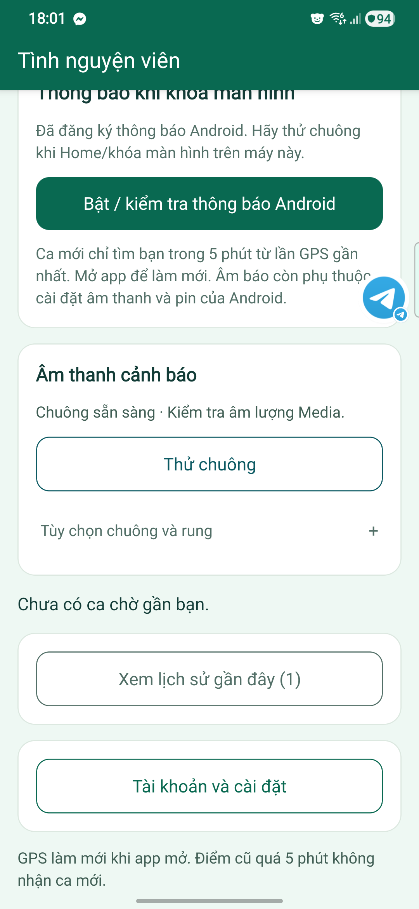

# Kiểm chứng0.4.16 — chuông Android sau thử S22+

[Trạng thái hiện hành](../../STATUS.md) · [Số liệu/log](VERIFICATION_V0_4_16.json) · [Bài kiểm tra USB](../../operations/ANDROID_TRIAL.md#5-phối-hợp-kiểm-thử-qua-usb--samsung-galaxy).

## Lỗi thật và nguyên nhân

S22+ SM-S906E/Android16 cài đè0.4.7→0.4.15, mở app/điều khiển UI thành công. Ở tài khoản TNV, chuông báo chưa chuẩn bị; người cầm máy không nghe hoặc chưa xác định. Log riêng EHIS có FileNotFoundException `/assets_emergencytone` ENOENT. Đối chiếu resource table của APK15: không có alias assets_emergencytone, nhưng named raw emergency_tone có. Tài nguyên có bytes không chứng minh player dùng đúng đường dẫn; giữ kết quả âm thanh15 **FAIL**.

## Sửa gì

- Android dùng URI của named raw resource emergency_tone mà plugin thông báo đã nhúng, thay cho alias Metro không tồn tại. iOS giữ asset cũ; không thêm dependency hoặc quyền.
- Verifier APK từ code14 bắt buộc bundle dùng đúng URI theo package và named raw resource tồn tại trong APK; tiếp tục kiểm tra tone bytes/backend/version/FCM.
- Metadata0.4.16/code14; backend chỉ đổi health version cho đồng bộ, không đổi xử lý ca, dữ liệu hoặc IAM/billing. Không tự tăng âm lượng, đổi chế độ im lặng/DND hoặc cấp quyền Android.

## Điều kiện ghi đạt

Source check/web build đạt trước EAS. APK build FINISHED và verifier đạt trước cài đè; người dùng không có ca active/TNV OFF. Trên S22+ mới phải thấy chuông sẵn sàng, không có lỗi đường dẫn mới, và người cầm máy xác nhận nghe/rung. Các bài Home/khóa/Im lặng, Media=0/DND và GPS phải ghi riêng; không suy từ chuông thử foreground.

Kết quả đang cập nhật theo JSON/STATUS. Chưa có kết quả máy của16 thì vẫn **Chưa thử**, không đổi FAIL15 thành PASS vì code sửa hoặc build thành công.

## Theo dõi bài thật theo thứ tự

| Bài | Bằng chứng hiện có | Kết luận |
| --- | --- | --- |
| USB đúng S22+/Android16 | ADB được chủ máy cấp quyền; không public serial | Đạt |
| Cài đè giữ dữ liệu |0.4.7→15 rồi15→16 install-r success; đọc lại code14, còn phiên TNV sau update16 | Đạt trên S22+ |
| Điều khiển UI | Cuộn/cài đặt/logout15;16 dùng UIAutomator đúng package/bounds để xác định và bấm Thử chuông | Đạt bước cơ bản15/16 |
| Chuông trong app15 | UI chưa chuẩn bị + FileNotFoundException + alias không có trong ARSC | Không đạt |
| Thông báo sau Home15 | Một FCM test không tạo ca; chủ máy thấy thông báo/nghe chuông/rung | Đạt một lượt, chưa suy nhiều điều kiện |
| Chuông trong app16 | Native UI báo sẵn sàng, bấm đúng nút10:59:18 UTC; chủ máy trả lời Có chuông và có rung | Đạt một lượt ở điều kiện máy hiện tại |
| Khóa máy/Im lặng/DND/lâu ở nền | Không lấy Home hoặc FCM ack thay thế | Chưa thử |
| GPS thực/độ trễ/chỉ đường | Mới kiểm tra quyền, chưa lấy điểm/đo | Chưa thử |
| Đa ca/ETA/receipt/bàn giao trên máy | Source/CI đã kiểm tra, chưa chạy đầy đủ trên điện thoại | Chưa thử |

Source d7f34d4: check local74 PASS, cloud build PASS, [CI42471477876 SUCCESS](https://github.com/Hoangcamng03/EHIS-Next/actions/runs/42471477876) gồm check/Android export/web build/integration/scale. Web/backend16 đã deploy và38 file cloud khớp build. EASc344677f FINISHED đúng source/version/code; APK102720249 bytes, SHA256 `066d2206cf2bb7659ddecb28d7da740a5b50ec09f75ca6d5bc2e3a38c3cdc820`. Verifier thực xác nhận URI player khớp named raw resource trong ARSC, không chỉ kiểm tra có WAV.

Cài16 trên S22+ thành công10:48:42.770 UTC08/11, sau khi kiểm tra V2 vẫn OFF/no active. Không gỡ/xóa dữ liệu, không tự bật quyền. Mirror đen lúc máy chưa mở khóa; chủ máy tự mở khóa, vào TNV. Cửa sổ Windows có độ trễ/ảnh cũ nên không dùng thao tác đó làm kết quả nghe; UIAutomator trên chính Android đọc đúng nút/bounds và bấm10:59:18.167 UTC. Người cầm máy xác nhận **Có chuông và có rung**. Log tiến trình16 thu11:01 không có marker lỗi hoặc alias hỏng đã biết; không suy toàn hệ thống không còn lỗi. Không đo latency nghe bằng hai đồng hồ.

Ảnh chỉ chứng minh UI nạp sẵn sàng; tiếng/rung dựa xác nhận trực tiếp của chủ máy. Không public token, serial, thông tin đăng nhập hoặc QR/bệnh án. FullDeviceAcceptance vẫn false vì các hàng Chưa thử ở trên. SDK ack bài Home15 không phải số đo độ trễ thiết bị.

Trang cài16 được build/deploy sau verifier và xác nhận nghe/rung;11:09:27 UTC08/11 kiểm tra online đúng APK đã hash và backend16.38 file HTML/JS/CSS khớp build ở lượt cuối. Kết thúc thử V2 OFF/no active; chỉ dọn XML UI/token copy tạm, giữ app/đăng ký thông báo/cửa sổ điều khiển. Runtime source d7f34d4; commit tài liệu/manifest sau đó không phải một binary khác.
